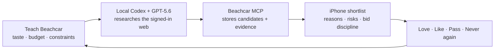
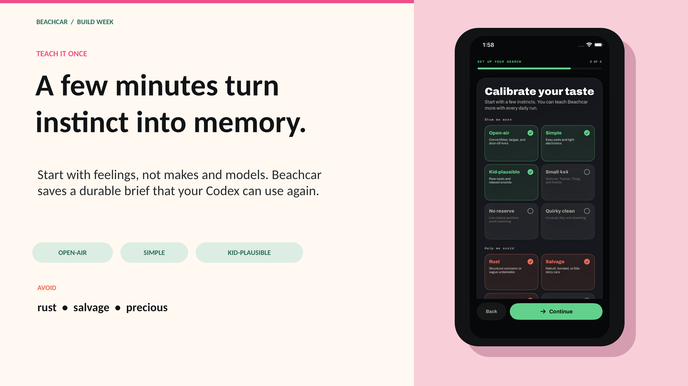
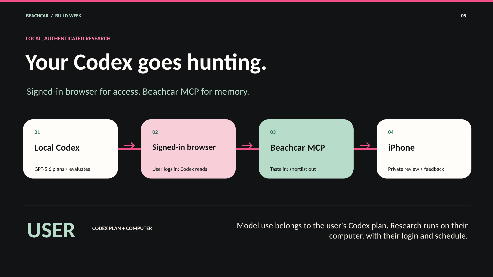
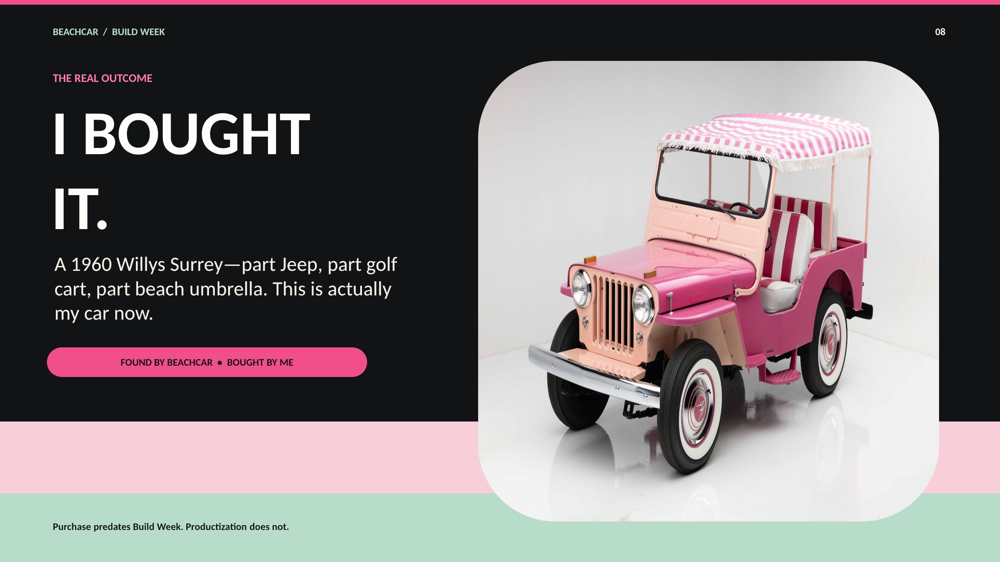
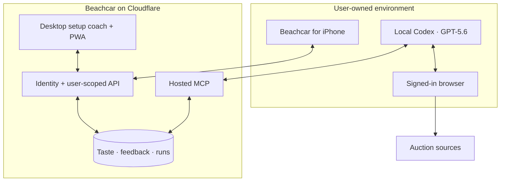

# Beachcar

<p align="center">
  
</p>

<h3 align="center">Your Codex. Your taste. Your car.</h3>

<p align="center">
  <strong>A personal auction scout that researches through your signed-in browser, publishes an evidence-backed shortlist, and learns from every swipe.</strong>
</p>

<p align="center">
  OpenAI Build Week 2026 · Apps for Your Life
</p>

Beachcar is for people who love charming, unusual cars but do not want auction hunting to become a second job. You teach it the difference between merely matching your filters and actually feeling right. Your local Codex does the open-ended research with the browser sessions you control. Beachcar supplies durable taste memory, a user-scoped MCP server, and a polished iPhone review experience.

The result is deliberately small: a few candidates with fit reasoning, market context, bid discipline, risks, sources, and honest uncertainty—not an endless feed of links.

## It found the one

After a couple of weeks of real use, Beachcar surfaced a [pink 1960 Willys DJ-3A Surrey](https://bringatrailer.com/listing/1960-jeep-dj-3a/). I bought it.

Beachcar did not make the decision or place the bid. It did the searching, taste matching, research, and narrowing that made one extraordinary human decision possible. That is the product thesis in one car: a personal agent should learn enough about you to find the thing no keyword alert would know to recommend—and give you enough evidence to act with confidence.

## The loop



1. **Teach it what “right” means.** The iPhone onboarding captures region, radius, budget, use case, sources, practical constraints, and the hard-to-filter qualities that make a car lovable.
2. **Hand the brief to Codex.** Beachcar coaches the user through connecting the bundled skill and hosted MCP on a desktop. The user signs into auction sites in their own browser; credentials never go to Beachcar.
3. **Let GPT-5.6 exercise judgment.** Codex uses the saved profile and prior feedback to plan research, compare messy evidence, explain fit, surface uncertainty, and decide which few candidates deserve attention.
4. **Publish, then verify.** Codex submits source-backed candidates through Beachcar's MCP, publishes the run, and verifies the exact shortlist the user will see.
5. **Make tomorrow better.** Like, Love, Pass, and Never again become durable preference events that steer the next run.

## Why Codex and GPT-5.6 matter

This is not a hosted chatbot with a car-themed prompt. The user runs Codex locally because it is the right place to combine personal judgment, an authenticated browser, recurring work, and specialized tools.

| Capability | Role in Beachcar |
| --- | --- |
| **Codex** | Orchestrates the research loop, follows the Beachcar skill, uses the user's local browser, calls the hosted MCP, and can run again on a personal schedule. |
| **GPT-5.6** | Converts nuanced taste and imperfect marketplace evidence into a research plan, comparative judgment, concise dossiers, and explicit uncertainty. |
| **Beachcar MCP** | Exposes user-scoped setup context, memory, candidate submission, publication, verification, and event history without storing an OpenAI key. |
| **SwiftUI app** | Turns agent output into a focused, tactile decision surface and captures high-signal feedback for the next run. |

The split preserves agency: the user owns the browser login, Codex subscription, model choice, and cadence. Beachcar specializes in memory, evidence, feedback, and presentation. The legacy hosted-research experiments remain in this repository, but they are not the Build Week submission path and are not required for the demo.

## Product experience

<table>
  <tr>
    <td align="center" width="33%"></td>
    <td align="center" width="33%"></td>
    <td align="center" width="33%"></td>
  </tr>
  <tr>
    <td valign="top"><strong>Calibrate.</strong><br>Durable taste is richer than filters.</td>
    <td valign="top"><strong>Hunt.</strong><br>Your Codex researches in the browser you control and publishes through Beachcar MCP.</td>
    <td valign="top"><strong>Find the one.</strong><br>The clearest product proof is now a very real pink car.</td>
  </tr>
</table>

The review model is intentionally fast and physical. Swipe right to **Like**, farther right to **Love it**; swipe left to **Pass**, farther left for **Never again**. Scroll down for the full dossier. Tap a photo for a separate zoomable gallery. Those judgments are not engagement signals—they are research instructions.

## Judge path

The no-secret judge experience is a fixed, clearly labeled replay of the product contract. It runs locally without paid infrastructure or private auction credentials and never presents itself as a captured production run:

1. Run `bun run dev`, then open [`http://127.0.0.1:5173/demo`](http://127.0.0.1:5173/demo).
2. **Proof** introduces the real Surrey Beachcar surfaced and its user bought.
3. **Teach** turns plain-language taste into durable memory.
4. **Research** shows the exact local Codex, signed-in browser, and MCP tool sequence represented by the fixture.
5. **Review** shows five clearly labeled fixture picks with reasons, caveats, market notes, and source slots.
6. **Learn** shows how Love and Never again change the next research brief.

Automated coverage verifies the replay state and the MCP contract separately. This replay does not claim that a live marketplace login, a production publication, or the owner/friend TestFlight acceptance run occurred inside the fixture.

See [the Build Week judge guide](docs/build-week/judge-guide.md) for the evaluation path and [the submission plan](docs/build-week/submission-plan.md) for the evidence checklist.

The repository also includes the [final real-photo judge deck](docs/build-week/Beachcar-Build-Week-final.pptx), [timed storyboard](docs/build-week/storyboard.md), [submission copy and YouTube kit](docs/build-week/submission-copy.md), [artifact manifest](docs/build-week/artifact-manifest.md), and [two-round owner/friend acceptance guide](docs/build-week/friend-e2e-test.md). The 1:41 Creator-tier Chris narration cut is a local, Git-ignored upload master—not a repository download. Its current hash is recorded in the manifest and must be re-frozen after any rebuild; the submission should use the verified public YouTube URL as the film link and, absent a verified hosted experience, a permanent final-commit permalink to the [judge guide](docs/build-week/judge-guide.md) for working-project access.

## Build Week extension

Beachcar existed before Build Week. The eligible submission is the meaningful extension built after the event opened: the local-Codex default, user-owned browser research, the Beachcar skill and MCP onboarding, the learning-loop demo, the new Surrey-led identity, and the judge-facing proof package.

- **Baseline:** [`e8321d0`](https://github.com/joncooper/beachcar/commit/e8321d0c27edd0d21aca2936ef04ae601e0ef4af), July 13, 2026 at 10:48 a.m. ET.
- **Candidate primary Codex task:** `019f8178-f7a2-7301-b9be-f5b0af997b70` (provisional; include it in the entry only after `/feedback` literally accepts or returns this value).
- **Detailed before/after record:** [Build Week changelog](docs/build-week/changelog.md).

Codex accelerated repository analysis, product implementation, native and web UI iteration, automated tests, visual identity work, and submission collateral. The important human decisions remained human: rejecting the hosted-cost story, insisting on a user-owned browser, choosing a tiny evidence-backed shortlist, defining the feedback semantics, and recognizing that the car Beachcar found is the honest emotional proof.

## Architecture



The Worker is the trust boundary. It verifies identity, scopes every read and write, and exposes the same product state to iOS, the web coach, and MCP clients. Auction credentials stay in the user's browser. OpenAI credentials stay with Codex. Beachcar stores neither.

## Built as a real product

| Surface | Implementation |
| --- | --- |
| **Native app** | SwiftUI, Clerk sign-in, resumable taste onboarding, desktop-Codex handoff, offline run cache, progressive gesture coaching, accessible layouts, and TestFlight release tooling. |
| **Desktop + web** | React PWA for setup coaching, onboarding, review, preferences, status, account controls, and deterministic demo states. |
| **Agent interface** | A Beachcar daily-run skill plus hosted Streamable HTTP MCP with scoped setup, memory, submission, publication, and verification tools. |
| **Data + media** | Cloudflare Worker, D1 user-scoped state, and R2 image cache/variants. |
| **Identity + privacy** | Clerk authentication, hashed tokens, OAuth metadata, export/delete, and a strict separation between auction-taste memory and product diagnostics. |
| **Verification** | Vitest coverage for Worker/web contracts plus native build checks and XCUITest coverage for onboarding, review, gestures, persistence, and the signed-out brand story. |

## Run it locally

The web and Worker code use Bun; the native app uses XcodeGen so the Xcode project remains reproducible.

```bash
bun install
cp .env.example .env.local
bun run typecheck
bun run test
VITE_CLERK_PUBLISHABLE_KEY=pk_test_build_validation bun run build
```

Build the native app:

```bash
bun run ios:generate
bun run ios:build
```

Focused guides:

- [Native iOS development and TestFlight](docs/ios.md)
- [Hosted MCP and local Codex setup](docs/remote-mcp-friend-automation.md)
- [Publishing contract and dossier schema](docs/publishing.md)
- [Cloudflare architecture and guarded deployment](docs/cloudflare.md)
- [Scraping and compliance notes](docs/scraping-and-compliance.md)

## Repository map

```text
.agents/skills/       Beachcar's local Codex research skill
ios/                  Native SwiftUI app and tests
src/client/           Desktop coach and React PWA
src/worker/           API, MCP, product state, and legacy hosted experiments
migrations/           D1 schema history
scripts/              Build, release, migration, and verification tooling
docs/build-week/      Judge guide, changelog, submission copy, and demo plan
```

## Project status

Beachcar is a personal project and private friend beta. The Build Week path uses the user's local Codex and browser; it does not require Beachcar-funded inference or authenticated cloud-browser scraping. A small public auction-feed cache may seed the search before local research. The app's first niche is beach cars and runabouts, but the memory, evidence, feedback, and publication model can support other high-consideration searches.

## Responsible use

Auction sites are living systems with their own terms, access controls, and rate limits. Beachcar uses conservative, user-directed research and only accesses signed-in pages through a browser session the user controls. Anyone adapting the project is responsible for marketplace terms and image rights. Third-party auction photography is not included in public competition collateral unless its use has been explicitly cleared.

MIT licensed. See [LICENSE](LICENSE).
