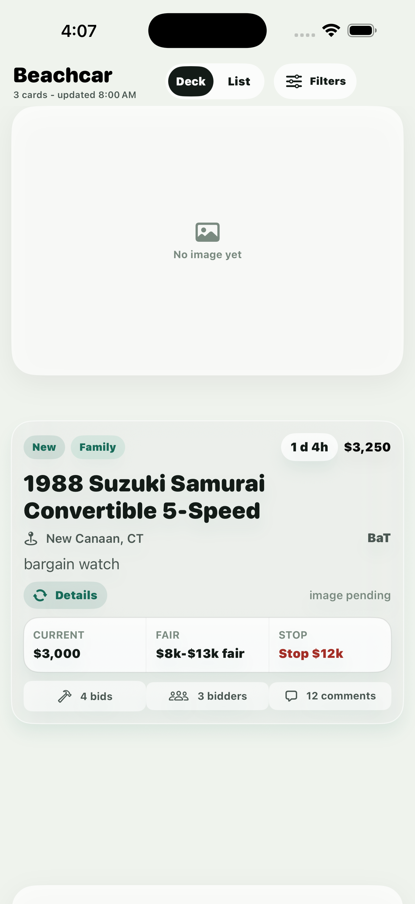
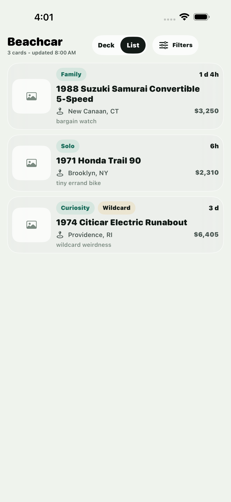
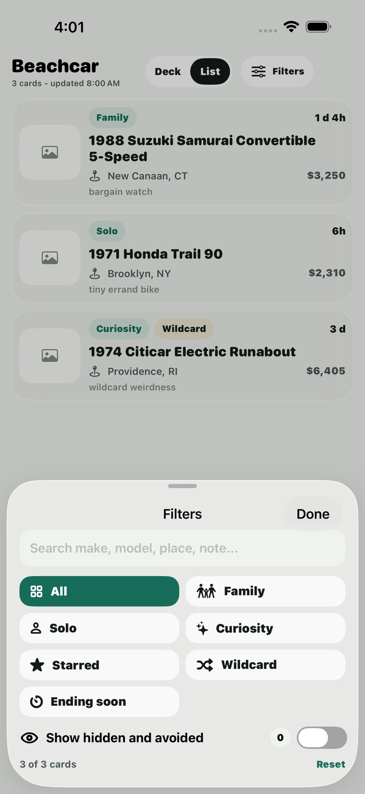
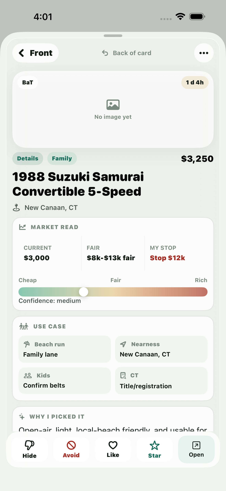

# Beachcar

Beachcar is a mobile-first auction watch app for people who want a daily AI agent to research listings, apply taste/preferences, estimate values, copy listing images, and publish a private shortlist.

The default example is a beach-car/runabout watchlist, but the app is intentionally reusable for other collector niches.

## What It Includes

- Cloudflare Worker serving a React PWA and JSON API.
- D1 database for invited users, profiles, source settings, AI settings, daily runs, listings, image metadata, usage events, runner tasks, and per-user feedback memory.
- R2 image cache with generated `thumb`, `deck`, and `full` variant URLs so listing photos stay fast on mobile.
- Clerk authentication with an `ALLOWED_EMAIL` bootstrap owner and invite-only friend access.
- Cloudflare Agents and Workflows for per-user run requests, schedule state, source discovery, image warmup, and run-status reporting.
- Cloudflare Container runner scaffold for Codex SDK/browser-heavy source work that should not run inside a Worker.
- Native SwiftUI iOS app for invite/onboarding states, cached image-first review, and run-status visibility.
- Feedback actions:
  - Like: show more like this without pinning it as a favorite.
  - Star: prioritize this listing and similar future finds.
  - Hide: remove this exact listing from the default view.
  - Avoid: suppress similar listings unless unusually compelling.
- Admin import, invite, user, AI usage, Agent run, and runner-task APIs for the daily automation and friend beta.
- Agent playbooks for Codex, Claude, or another browser-capable AI operator.

## Native iOS Preview

The native app is an image-first review surface for daily auction finds. The primary mode is a one-listing deck: swipe photos horizontally, move through vehicles vertically, like/hide/star/avoid with card gestures, tap for the back-of-card detail view, or jump into list and filter modes when scanning.

These are actual iPhone simulator screenshots from the current SwiftUI app:

<p>
  
  
  
  
</p>

## Operating Model

Beachcar supports two run paths:

1. A local/hosted AI automation can still publish normalized daily data through the admin import API.
2. A signed-in user can request an Agent-backed run. The per-user Cloudflare Agent starts a Workflow, loads that user's profile/source/feedback context, discovers public candidates, scores them through AI Gateway when configured, imports a user-scoped run, warms image variants, and queues blocked source work for the runner-task/Container boundary.

For the external daily automation path:

1. Fetch feedback memory from `GET /api/admin/feedback/export`.
2. Search/scrape auction sites using the user's own browser/session/API access.
3. Evaluate listings against the user's profile and prior feedback.
4. Estimate fair value and a practical bid ceiling.
5. Collect useful image URLs.
6. Emit normalized JSON.
7. Publish to `POST /api/admin/import` or `POST /api/admin/users/:userId/runs/import`.
8. Copy images into R2 through the publish flow.

The app is the hosted review and memory surface. The agent is the collector, analyst, and publisher.

## Local Setup

```bash
npm install
cp .env.example .env.local
cp .publish.env.example .publish.env
```

Fill in `.env.local` with your Clerk keys and desired app name.

```bash
npm run typecheck
npm test
set -a; source .env.local; set +a
npm run build
```

Run the repeatable local preflight:

```bash
npm run preflight
```

The quick preflight includes the non-deploying readiness report below, but leaves known rollout todos non-fatal.

To exercise the Agent/Workflow/D1/R2 path locally, make sure `.dev.vars` or `.publish.env` has `PUBLISH_TOKEN`, then run:

```bash
npm run preflight:local
```

The local preflight starts `wrangler dev --local`, waits for it to become ready, runs `npm run smoke:local-worker`, and stops the local Worker afterward.

For the larger local gate that also builds the native app:

```bash
npm run preflight:full
```

Before any intentional deploy rehearsal, run the non-deploying readiness check:

```bash
npm run deploy:check
```

It inspects local config, migrations, script wiring, and env hints without contacting Cloudflare or printing secret values. Add `-- --strict` when you want missing deploy/friend-rollout items to fail CI.

## Native iOS App

The native app lives in `ios/` and is generated from `ios/project.yml` with XcodeGen, so you can work without opening Xcode. It uses Clerk with Google auth, talks to the same Worker API as the PWA, and supports TestFlight builds from the command line.

```bash
npm run ios:generate
npm run ios:resolve
npm run ios:build
```

Useful commands:

```bash
npm run ios:sim
npm run ios:test-ui
npm run ios:archive
npm run ios:testflight
```

Use `npm run ios:release` when shipping app changes; it archives, uploads to App Store Connect, waits for the new build to appear, and assigns it to the configured internal TestFlight group.

See `docs/ios.md` for the native UX model, Clerk setup, and simulator/device notes.

## Cloudflare Setup

Create resources:

```bash
npx wrangler d1 create beachcar-watch
npx wrangler r2 bucket create beachcar-watch-images
```

Copy the D1 `database_id` into `wrangler.jsonc`, then set the bootstrap owner email:

```jsonc
"vars": {
  "ALLOWED_EMAIL": "you@example.com",
  "ENVIRONMENT": "production"
}
```

`ALLOWED_EMAIL` is not the only allowed account anymore. It identifies the first active owner; other signed-in users are created as `invited` and must accept an invite code before they can load runs or save feedback.

Apply migrations and set Worker secrets when you are ready to deploy:

```bash
npm run db:migrate:remote
npx wrangler secret put PUBLISH_TOKEN
npx wrangler secret put CLERK_SECRET_KEY
npx wrangler secret put CLERK_JWT_ISSUER
npm run deploy
```

`CLERK_JWT_ISSUER` is your Clerk issuer URL, usually like `https://your-instance.clerk.accounts.dev`.

## Publishing A Daily Run

Configure `.publish.env`:

```bash
AUCTION_WATCH_URL=https://beachcar-watch.<your-workers-subdomain>.workers.dev
PUBLISH_TOKEN=<same value configured as Worker secret>
```

Publish sample data:

```bash
npm run publish:daily
```

Publish a real daily run:

```bash
DAILY_JSON=outputs/daily-run-2026-06-20.json npm run publish:daily
```

The publish script imports the run first, then copies queued listing images to R2 through the admin image API.

## Friend Beta Flow

1. Sign in as the bootstrap owner.
2. Open the admin console from the PWA and create an invite.
3. Friend signs in with Clerk, enters the invite code, and completes onboarding.
4. Friend configures profile, source toggles, schedule, AI mode, and budget caps.
5. Friend reviews their own latest run in the PWA or iOS app.
6. Feedback, preference events, AI usage, Agent runs, and account export/delete stay scoped to that user.

Friends do not need to paste raw OpenAI keys for the first beta. Prefer managed Cloudflare AI Gateway budgets. If BYOK is enabled, store the provider key in Cloudflare AI Gateway/Secrets Store and save only the gateway key reference in Beachcar.

The Container runner stays deterministic unless explicitly configured. To test a deployed Codex-backed runner intentionally, set `BEACHCAR_RUNNER_MODE=codex`, optionally set `BEACHCAR_CODEX_MODEL`, and provide the runner credential as a Worker secret such as `OPENAI_API_KEY`. Do not store friend-provided raw keys in D1.

## AI Automation

Start with:

- `automation/codex-daily-run.md`
- `automation/claude-daily-run.md`
- `automation/auction-source-playbook.md`
- `automation/preference-steering.md`
- `automation/valuation-guide.md`
- `automation/source-profile.beach-cars.md`

The automation instructions are intentionally explicit because auction pages change. A browser-capable AI agent should inspect pages live, adapt extraction, and keep producing the stable import JSON shape documented in `docs/publishing.md`.

## Compliance

You are responsible for how your automation accesses third-party sites. Use your own credentials where needed, respect rate limits and site terms, do not bypass access controls, and do not publish copied images beyond your intended private/internal use unless you have rights to do so.

## Project Status

This worktree contains a local friend-beta implementation. No production deploy is implied by the local preflight. Before inviting real friends, run `npm run preflight:full`, deploy intentionally, then verify the remote Worker, D1 migrations, AI Gateway budget policy, image variant creation, and Container runner against the deployed Cloudflare account.
