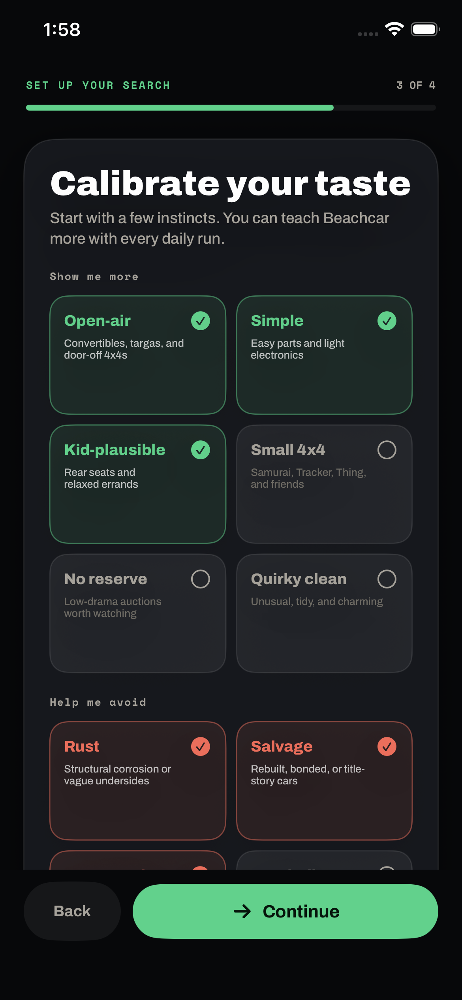
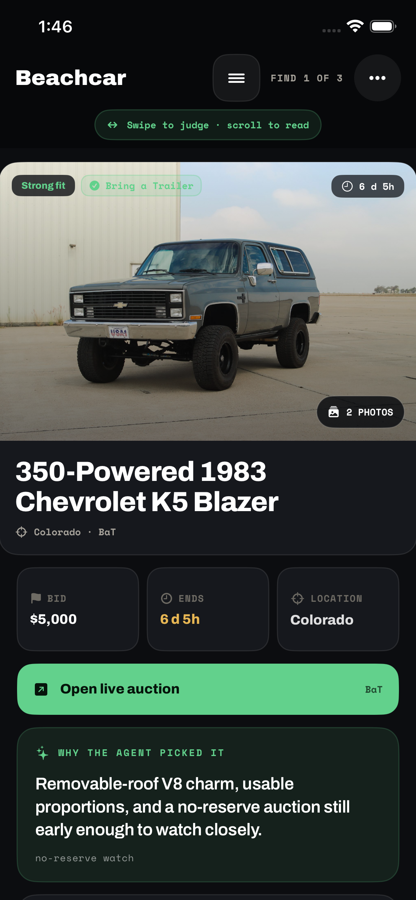
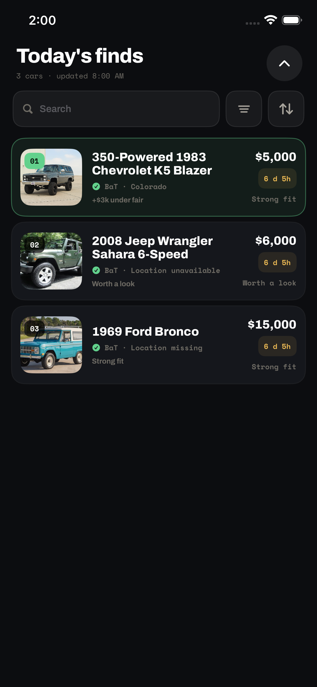
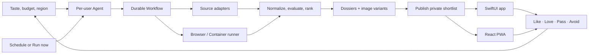
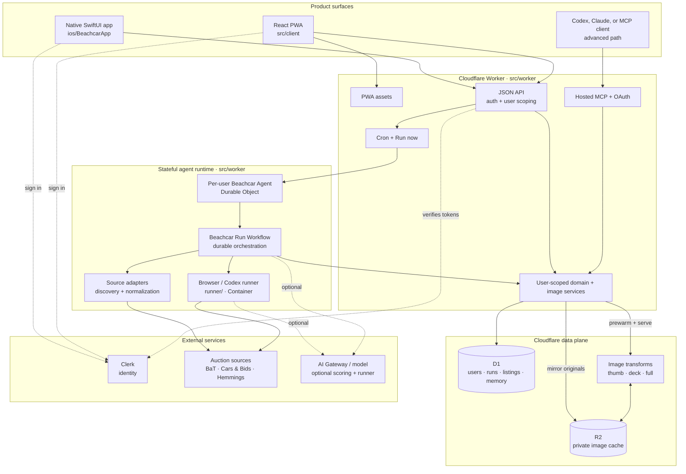

# Beachcar

<p align="center">
  
</p>

<h3 align="center">An AI auction scout that researches the market, explains its judgment, and learns your taste.</h3>

<p align="center">
  <em>SwiftUI + Cloudflare Agents, Workflows, Durable Objects, Containers, D1, R2, Clerk, and a React PWA.</em>
</p>

Beachcar is a private AI auction scout I built for people who love charming, unusual cars but do not want auction hunting to become a second job.

Each day it searches live marketplaces, reconciles messy listing data, evaluates candidates against one person's budget, location, taste, and prior feedback, then publishes a deliberately small shortlist. Every pick arrives with an opinionated dossier: why it fits, what the market says, what could go wrong, and where to stop bidding.

This is an end-to-end agentic product—not a chat wrapper. It schedules work, uses tools, delegates browser-heavy research, preserves per-user memory, recovers from partial failures, and makes its reasoning inspectable in native iOS and web apps. Managed research can run deterministically by design; optional AI Gateway scoring and a Codex-backed Container deepen judgment and browser work without becoming hidden requirements.

## The product

<table>
  <tr>
    <td align="center" width="33%"></td>
    <td align="center" width="33%"></td>
    <td align="center" width="33%"></td>
  </tr>
  <tr>
    <td valign="top"><strong>1. Teach it what matters.</strong><br>Region, radius, budget, use case, sources, and taste become durable research context.</td>
    <td valign="top"><strong>2. Get judgment, not links.</strong><br>Each pick includes fit reasoning, valuation, bid discipline, watch-outs, and a source-backed dossier.</td>
    <td valign="top"><strong>3. Review a shortlist, not a feed.</strong><br>Listings and photos have distinct navigation, with search, filters, and explicit progress.</td>
  </tr>
</table>

<p align="center"><sub>Real captures from the current SwiftUI app running in the iPhone simulator; listing media was loaded from the project's live-source research output.</sub></p>

The interaction model is intentionally fast and physical. Swipe right to **Like**, farther right to **Love it**; swipe left to **Pass**, farther left for **Never again**. Scroll down to read the full dossier. Tap a photo to enter a separate zoomable gallery, then swipe decisively up or down to return. Those judgment gestures do more than organize the current deck—they become preference memory for the next research run.

## Why I built it

Auction alerts are good at finding matches and bad at exercising judgment. A keyword can locate every old 4x4; it cannot tell whether a particular one is charming rather than compromised, fairly priced rather than merely cheap, or plausible for school runs and beach days.

Beachcar explores a more useful relationship between a person and an agent:

- The person defines taste, constraints, and risk tolerance.
- The agent does open-ended research and narrows the field.
- The product exposes evidence and uncertainty instead of presenting magic.
- Lightweight feedback compounds into better future decisions.

The goal is not maximum engagement. It is a few unusually good decisions, delivered at the right time.

## What makes it agentic



| Agent capability | How Beachcar uses it |
| --- | --- |
| **Autonomy** | Time-zone-aware schedules and signed-in “Run now” requests start research without an operator driving each step. |
| **Tool use** | Source modules inspect auction feeds and pages; browser-heavy work can hand off to an isolated Cloudflare Container runner. |
| **Durable execution** | Cloudflare Workflows coordinate discovery, scoring, publication, image warming, and terminal status across long-running work. |
| **Memory** | Per-user feedback and preference events are loaded into later runs, changing both ranking and suppression. |
| **Judgment** | Candidates are assessed for fit, value, practical constraints, risk, novelty, and confidence—not only keyword similarity. |
| **Observability** | Users and operators can inspect source checks, candidate counts, runner handoffs, failures, usage, and the exact published result. |
| **Extensibility** | A hosted MCP surface lets technical users connect Codex, Claude, or another capable agent without changing the friend-facing product. |

That traceability is deliberate. Source failure is not the same as “nothing worth showing,” missing location is not silently treated as local, and a runner handoff is not reported as a completed run. Every run retains its workflow identity, source diagnostics, candidate funnel, final publication, and human-readable errors.

## Design decisions I care about

- **A shortlist beats a feed.** Scarcity keeps the agent accountable for each recommendation.
- **Reasons belong beside the recommendation.** Fit, market context, confidence, and watch-outs are part of the core object—not an expandable AI garnish.
- **Taste is richer than filters.** “Open-air, charming, kid-plausible” is useful context even when it cannot be reduced to a checkbox.
- **Missing data should look missing.** The UI distinguishes no photo, failed loading, unknown location, and weak valuation evidence.
- **The default should feel effortless.** Friends do not need an API key, automation token, MCP client, or knowledge of the agent stack.
- **Advanced power can remain available.** Operators get source controls, usage accounting, scoped automation, and reproducible fallback playbooks without exposing that machinery during onboarding.

## Built as a real product

Beachcar spans the product surface, agent runtime, data plane, authentication, operations, and release pipeline.

| Surface | Implementation |
| --- | --- |
| **Native app** | SwiftUI, Clerk authentication, offline run cache, image prefetching, zoomable gallery, gesture feedback, accessibility-aware layouts, and internal TestFlight distribution. |
| **Web app** | Mobile-first React PWA for onboarding, review, preferences, run history, status, account controls, and administration. |
| **Agent runtime** | Cloudflare Agents + Durable Objects for per-user state, Workflows for durable orchestration, and Containers for browser/Codex-backed jobs. |
| **Data + media** | D1 for user-scoped product and run state; R2 plus Cloudflare Images for cached `thumb`, `deck`, and `full` photo variants. |
| **Identity + privacy** | Invite-only Clerk access, user-scoped reads and writes, hashed automation tokens, OAuth metadata, export, and deletion. |
| **Operations** | Guarded D1 migrations, private recovery artifacts, staged container rollout, strict configuration checks, production smoke tests, and managed-path verification. |

The current verification suite includes **151 Vitest tests** across the web/Worker surface and **25 native tests**: 18 end-to-end XCUITests plus seven gesture-model unit tests.

## A typical daily run

1. A schedule or signed-in request starts the user's Agent and loads profile constraints, source settings, and feedback memory.
2. Source adapters gather candidates; browser-dependent work can move to the isolated Container runner.
3. The Workflow normalizes evidence, evaluates fit and value, and selects a small, diverse set—using deterministic or optional model-backed scoring.
4. It publishes the run to D1, mirrors and warms image variants in R2, and records source-by-source diagnostics.
5. The friend reviews in iOS or the PWA; that feedback changes the next run.

## System map: runtime architecture

The earlier loop describes the product behavior. This view shows the runtime boundaries and the repository area that owns each moving part.



The Worker is the trust boundary: it verifies identity, scopes every read and write to a user, and exposes the same product state to iOS, the PWA, and optional MCP clients. Durable Objects hold per-user agent state, Workflows own long-running execution, and the Container is available for work that is too browser-heavy or open-ended for a request-bound Worker.

## Run it locally

The web and Worker code use Bun; the native app uses XcodeGen so the Xcode project remains reproducible.

```bash
bun install
cp .env.example .env.local
```

Add the Clerk values described in `.env.example`, then verify the web and Worker surfaces:

```bash
bun run typecheck
bun run test
bun run build
```

Run the local Worker integration preflight:

```bash
bun run preflight:local
```

Build and launch the iOS app:

```bash
bun run ios:generate
bun run ios:build
bun run ios:sim
```

For configuration details, see the focused guides instead of treating this README as an operator manual:

- [Native iOS development and TestFlight](docs/ios.md)
- [Cloudflare architecture and guarded deployment](docs/cloudflare.md)
- [Publishing contract and dossier schema](docs/publishing.md)
- [Hosted MCP and bring-your-own-agent path](docs/remote-mcp-friend-automation.md)
- [Scraping and compliance notes](docs/scraping-and-compliance.md)

## Repository map

```text
ios/                 Native SwiftUI app, unit tests, and XCUITests
src/client/          React PWA
src/worker/          API, Agent, Workflow, MCP, and data layer
runner/              Isolated browser / Codex Container runner
migrations/          D1 schema history
automation/          Research and operator fallback playbooks
scripts/             Build, release, migration, and verification tooling
docs/                Architecture and operations guides
```

## Project status

Beachcar is running as a private friend beta: the Worker/PWA is deployed, the managed research path is operational, and the native app is distributed through internal TestFlight. The default niche is beach cars and runabouts, but the profile, feedback, orchestration, and publication model are deliberately reusable for other high-consideration searches.

## Responsible use

Auction sites are living systems with their own terms and rate limits. Beachcar uses explicit source modules, conservative access patterns, operator-owned credentials where required, and a private image cache. Anyone adapting the project is responsible for respecting access controls, marketplace terms, and image rights.
