# Friends Platform Build Summary

Date: 2026-06-25

No production deploys were run. Verification was local only.

## Planning Passes

### Plan pass 1

Review: The architecture plan described the destination, but did not define the first end-to-end beta slice tightly enough.

Improvement: Added `First End-to-End Beta Slice` with concrete acceptance criteria: invite, sign-in, onboarding, user-scoped run, per-user feedback, user-specific feedback export, cached image variants, and no raw OpenAI keys in D1.

Verification: `rg` confirmed the new section and acceptance criteria are present in `docs/friends-platform-plan.md`.

### Plan pass 2

Review: Key handling was directionally right, but privacy, deletion, audit, and admin/user boundaries were under-specified.

Improvement: Added `Security And Privacy Requirements`, covering server-derived `user_id`, admin/user API separation, external secret references, audit events, export/delete, and private-by-default signup.

Verification: `rg` confirmed the security/privacy anchors in `docs/friends-platform-plan.md`.

### Plan pass 3

Review: The plan needed implementable API, migration, and verification contracts.

Improvement: Added beta API contract, migration sequence, and verification gates.

Verification: `rg` confirmed the API contract, migration sequence, and verification gates are present.

## Build Pass

### Backend and data model

Implemented:

- New D1 migrations: `migrations/0005_multi_user_beta.sql`, `migrations/0006_ai_usage.sql`
- `users`, `invites`, `profiles`, `source_settings`, `user_ai_settings`, `ai_usage_events`, `audit_events`, `agent_runs`, and `image_variants`
- User-scoped `runs`, `feedback`, and `preference_events`
- Legacy owner compatibility through null legacy `user_id` reads for the bootstrap owner
- Stable beta user ids based on normalized email
- Invite creation and invite acceptance
- User profile upsert
- User-scoped latest run, feedback, preference events, and feedback export
- Admin invite/user-list/user-run import/user-feedback export routes

### PWA

Implemented:

- Invite-required screen for signed-in but inactive users
- Initial preference onboarding screen
- Admin friend-access console for creating invites and listing users with a publish token
- Profile save API integration
- Per-user source toggles backed by `source_settings`
- Account export and confirmed account deletion from Preferences
- Dev-only visual harness for deterministic local screenshots
- Nearby image preloading in the deck flow
- Service worker cache-first handling for `/api/images/*` without caching authenticated JSON API payloads

### Docs

Implemented:

- `docs/friends-platform-plan.md`
- Updated `docs/auth.md` for bootstrap owner plus invite-based friend access
- This summary document

## App/Architecture Review Passes

### App/architecture pass 1

Review: The dev screenshot harness returned before normal app hooks, which was useful for screenshots but not ideal React structure.

Improvement: Split the normal app into `AuthenticatedApp` and kept `App` as a wrapper that selects dev demo states only in Vite dev mode.

Verification: `npm run typecheck` passed.

### App/architecture pass 2

Review: The review flow still fetched images reactively as users advanced through listings.

Improvement: Added client-side preloading for nearby images and cache-first service worker handling for image endpoints.

Verification: `npm run typecheck`, `npm test`, and local build passed.

### App/architecture pass 3

Review: `docs/auth.md` still described the old single-user `ALLOWED_EMAIL` model.

Improvement: Updated auth docs to describe bootstrap owner behavior, invited-user status, invite acceptance, user-scoped access, and iOS beta limits.

Verification: Documentation now matches the implemented route/model behavior.

### App/architecture pass 4

Review: Backend admin invite routes existed, but there was no app surface to use them.

Improvement: Added an admin friend-access console with publish-token input, invite creation, user refresh, invite-code display, and user status table. Added a deterministic `?demo=admin` screenshot mode and a live local `?admin=1` mode that calls the real admin APIs.

Verification: `npm run typecheck`, `npm test`, and local build passed. Browser screenshots confirmed desktop and mobile admin layouts.

### App/architecture pass 5

Review: Local verification could prove the UI rendered, but not that the Worker distinguished owner and friend identities without Clerk.

Improvement: Added a local-only `X-Beachcar-Test-Email` auth fallback for localhost/no-auth-provider development. It lets local smoke tests exercise multiple users without real Clerk sessions.

Verification: Added unit coverage for normalized local test identity. Started a local Worker and verified:

- `you@example.com` returns active bootstrap owner from `/api/me`
- `friend@example.com` returns invited status from `/api/me`
- invited friend receives `403 {"error":"Invite required"}` from `/api/runs/latest`

### App/architecture pass 6

Review: Initial onboarding existed, but an active user had no obvious place to revise preferences after setup.

Improvement: Added a preferences sheet reachable from the app header. It reuses the profile save API for display name, region, budget ceiling, stretch budget, prioritize notes, and avoid notes. Added a deterministic `?demo=settings` screenshot mode and tuned the sheet height for phone viewports.

Verification: `npm run typecheck`, `npm test`, and local build passed. Browser screenshots confirmed desktop and mobile preferences layouts.

### App/architecture pass 7

Review: The native iOS app still treated any signed-in Clerk user as ready for the deck, so invited friends or users without onboarding would see backend errors instead of account setup states.

Improvement: Added iOS `UserPayload`/profile models, `/api/me`, invite acceptance, and profile save API helpers. Updated `RootView` to gate signed-in users through invite entry, onboarding preferences, disabled-account blocking, and only then the existing review deck.

Verification: `npm run ios:build` passed locally with code signing disabled. No TestFlight upload or production deploy was run.

### App/architecture pass 8

Review: Client image handling preloaded nearby photos and cache-firsted image URLs, but those URLs still represented full-size originals, which wastes bandwidth for list thumbnails and repeated deck review.

Improvement: Added `?variant=thumb|deck|full` image URLs. Latest-run payloads now return deck-sized image URLs by default; the web list/sticky strip and iOS list thumbnails request `thumb`. The Worker can create WebP variants through Cloudflare image resizing, store them in R2, track them in the existing `image_variants` table, and serve immutable cached responses afterward.

Verification: `npm run typecheck`, `npm test`, local client build, and `npm run ios:build` passed.

### App/architecture pass 9

Review: The plan called for Cloudflare Agents/Workflows, but the app had no executable handoff point for per-user "run now" requests.

Improvement: Added `AgentRunRecord` types, D1 helpers, authenticated `POST /api/agent-runs`, authenticated `GET /api/agent-runs/latest`, and a compact web header control that queues a manual run request. The row is marked `queued` with `handoff: "queued_for_cloudflare_agent"` so the later Agents SDK/Workflow worker has a stable contract without running Codex or a scheduler locally.

Verification: `npm run typecheck`, `npm test`, and local client build passed. Local Wrangler smoke created a queued agent run for `you@example.com` and read it back from `/api/agent-runs/latest`.

### App/architecture pass 10

Review: The previous handoff still created `agent_runs` directly from the stateless Worker, so it did not yet prove Cloudflare Agents SDK wiring, Durable Object bindings, or per-user scheduling state.

Improvement: Installed `agents@0.16.2`, added `BeachcarAgent`, exported it from the Worker, configured the Durable Object binding plus SQLite migration in `wrangler.jsonc`, and typed `Env.BeachcarAgent`. Authenticated `POST /api/agent-runs` now calls the per-user Agent via `getAgentByName`, and profile saves sync completed users' `scheduleCron` into the Agent with a cron schedule for future scheduled runs.

Verification: `npm run typecheck`, `npm test`, local client build, and `npm run ios:build` passed. Local Wrangler showed `env.BeachcarAgent` as a Durable Object binding, then successfully created a queued run through the Agent-backed `/api/agent-runs` path. Local profile save also returned `canRunNow: true` and exercised Agent schedule sync.

### App/architecture pass 11

Review: Agent-backed run requests were queued, but there was no concrete handoff for a runner to claim a job, receive per-user context, publish normalized results, and close the run out.

Improvement: Added admin-only runner endpoints for claiming queued Agent runs, peeking at the next queued run, publishing normalized results, and marking failures. Added D1 state helpers for `queued -> running -> published/failed`, and added `scripts/run-agent-job-local.mjs` plus `npm run agent:run-local` to simulate a local external runner using the existing sample daily-run JSON.

Verification: With local Wrangler and a fake local `.dev.vars` publish token, the simulator claimed queued Agent runs, published two sample listings into user-scoped runs, returned `/api/runs/latest` with deck image variant URLs, moved `/api/agent-runs/latest` to `published`, and left `/api/admin/agent-runs/next` empty.

### App/architecture pass 12

Review: The plan and schema included managed/BYOK AI configuration, but the app had no user-facing way to set AI mode or budgets, and `/api/me` did not return `user_ai_settings`.

Improvement: Added `UserAiSettings` to the shared API contract, surfaced it in `/api/me`, added authenticated `PUT /api/ai-settings`, and wired onboarding/preferences to save managed/BYOK mode, daily/monthly caps, and an AI Gateway key reference. The Worker rejects raw-looking provider keys so D1 stores only references, not OpenAI keys.

Verification: `npm run typecheck`, `npm test`, and local client build passed. Local smoke saved managed settings, saved a BYOK gateway reference, and returned `400 {"error":"Store provider keys in AI Gateway BYOK, then save the gateway key reference here"}` for a raw-looking `sk-proj-...` value. Refreshed onboarding and settings screenshots show the AI controls.

### App/architecture pass 13

Review: The local claim/publish runner proved the execution contract, but normal user "Run" requests still depended on an external process to claim queued work. The architecture plan called for Cloudflare Workflows as the durable execution layer.

Improvement: Added `BeachcarRunWorkflow` with an explicit Workflow binding, exported it from the Worker, typed `Env.BEACHCAR_RUN_WORKFLOW`, and changed `BeachcarAgent` to call `runWorkflow()` for manual and scheduled runs. The initial Workflow used durable steps to mark the Agent run running, load profile/feedback context, generate a temporary two-card shortlist, publish a user-scoped run with an idempotent run id, and mark the Agent run published or failed. The external claim/publish API remains as a future Container/Codex bridge and fallback path.

Verification: `npm run typecheck`, `npm test`, local client build, and `npm run ios:build` passed. Local Wrangler showed `env.BEACHCAR_RUN_WORKFLOW` as a Workflow binding. `POST /api/agent-runs` returned a `running` Agent run with `workflowInstanceId`, then `/api/agent-runs/latest` moved to `published`, `/api/runs/latest` returned the Workflow-generated user-scoped run, and `/api/admin/agent-runs/next` returned no queued work.

### App/architecture pass 14

Review: The Workflow smoke was proven with manual curl commands, but that made regression checks slow and easy to skip.

Improvement: Added `scripts/smoke-local-worker.mjs` and `npm run smoke:local-worker`. The script uses the local Worker auth fallback, saves onboarding preferences, saves managed/BYOK AI settings, verifies raw provider keys are rejected, starts a manual Agent run, polls for Workflow publication, verifies `/api/runs/latest`, and confirms no external runner fallback job remains queued.

Verification: With local Wrangler running in `--local` mode, `npm run smoke:local-worker` passed for `you@example.com` and published a two-listing Workflow run through `env.BEACHCAR_RUN_WORKFLOW`.

### App/architecture pass 15

Review: The security plan required account export and deletion before inviting non-technical friends, but only feedback export existed. The PWA and service worker also still had a cross-user offline-cache risk around `/api/runs/latest`.

Improvement: Added authenticated `GET /api/account/export` and `DELETE /api/account`. Export returns the signed-in user's profile, AI/source settings, feedback export, user-owned runs, and Agent run history. Delete requires email confirmation, deletes private user-owned rows, disables the user, and preserves shared listing/image cache rows. The Preferences sheet now exposes export/delete controls, the disabled-account state has its own screen, and `/api/runs/latest` offline fallback is keyed by user id while the service worker no longer caches authenticated JSON API responses.

Verification: `node --check scripts/smoke-local-worker.mjs`, `npm run typecheck`, `npm test`, and local client build passed. The expanded local Worker smoke created a temporary invited friend, accepted the invite, onboarded, ran the Workflow, exported account data, deleted the account, verified `/api/me` returned `disabled`, verified `/api/runs/latest` returned `403 Account disabled`, and verified the admin user list showed the deleted account as disabled.

### App/architecture pass 16

Review: The database had `source_settings`, but onboarding and Preferences still stored source choices only in profile JSON. That made source controls hard for the Workflow and future runner to trust.

Improvement: Added authenticated `PUT /api/source-settings`, a D1 upsert helper, source toggles in onboarding and Preferences, source settings in account export/delete, and enabled-source metadata in the Workflow run summary. The old profile `sources` list is still written for compatibility, but D1 `source_settings` is now the authoritative per-user source-control surface.

Verification: `node --check scripts/smoke-local-worker.mjs`, `npm run typecheck`, `npm test`, local client build, and `npm run smoke:local-worker` passed. The local smoke now saves source settings for the owner and a temporary invited friend, verifies source settings in account export, and verifies deletion removes source settings.

### App/architecture pass 17

Review: The Cloudflare Workflow still published a deterministic two-card demo shortlist, so user "Run" actions proved orchestration but did not prove source discovery.

Improvement: Added a Worker-side source discovery module that fetches public Bring a Trailer keyword pages, parses live listing cards, scores candidates against the saved beach-car profile, and publishes source checks in `sourceSummary`. Cars & Bids and marketplace-style sources are now reported as blocked when they need a browser/container runner instead of being silently faked. The Workflow now publishes with `cloudflare-workflow-source-discovery`, carries `checkedSources`, `blockedSources`, `fallbackUsed`, and `rawCandidateCount`, and falls back only to transparent manual-check tasks when no live candidates clear the threshold.

Verification: `node --check scripts/smoke-local-worker.mjs`, `npm run typecheck`, `npm test`, local client build, and `npm run smoke:local-worker` passed. The local smoke published 8 real BaT-derived listings through the Workflow, reported `fallbackUsed: false`, captured BaT source checks, and marked Cars & Bids as blocked by its public fetch challenge.

### App/architecture pass 18

Review: Real source listings created image rows, and the app already served `thumb`, `deck`, and `full` variants on demand, but first user view still paid the source-fetch/variant-write cost because nothing warmed variants after publication.

Improvement: Moved image serving, mirroring, and variant creation into a shared Worker image-cache module. Admin imports now start bounded image warmup with `ctx.waitUntil`, and Workflow-backed runs warm the first image per listing for `thumb` and `deck` before marking the Agent run published. The warmup is capped to the first six listing images so the deck is snappy without turning every run into an unbounded image-copy job. Image responses now identify variant cache hits/misses with `X-Beachcar-Image-Variant` and `X-Beachcar-Image-Cache`.

Verification: `node --check scripts/smoke-local-worker.mjs`, `npm run typecheck`, `npm test`, local client build, and `npm run smoke:local-worker` passed. The smoke now fetches the first `/api/images/...?...variant=deck` URL after a Workflow run and asserts a `200` response, `X-Beachcar-Image-Variant: deck`, `X-Beachcar-Image-Cache: hit`, and non-empty bytes.

### App/architecture pass 19

Review: Friends should be able to drive their own cloud agent without running a local MCP server, but the app only exposed admin/runner APIs and repo playbooks.

Improvement: Added a hosted remote MCP preview at `/mcp`, backed by revocable user-scoped automation tokens and an `automation_events` activity log. Added Preferences > Connect automation for creating/revoking tokens, downloading a Beachcar daily-run skill, seeing the MCP endpoint, and reviewing recent automation activity. Added MCP tools for setup context, daily research planning, BaT public RSS search, candidate validation, run publishing, usage recording, latest-run verification, and event listing. Account export/delete now includes automation tokens/events.

Verification: `npm run typecheck` passed. The skill scaffold was created with the skill-creator initializer; the validator script could not run because both available Python runtimes are missing `yaml`.

### App/architecture pass 19

Review: Users could configure managed/BYOK AI settings and caps, but there was no usage ledger, budget summary, or ingestion endpoint for Gateway/runner spend. That meant caps were advisory UI state rather than enforceable per-user controls.

Improvement: Added `ai_usage_events` with Gateway request ids, provider/model metadata, token counts, cost in microusd, and per-user indexes. `/api/me`, `/api/ai-usage`, account export, account deletion, and the admin users list now include daily/monthly AI usage summaries. Added admin-only `POST /api/admin/ai-usage` for Gateway/runner ingestion and `GET /api/admin/users/:id/ai-usage` for inspection. Agent run creation now checks the usage summary and returns `402` when the user's AI budget is already exceeded. The Preferences AI panel and admin user table show daily/monthly spend against caps.

Verification: Applied `0006_ai_usage.sql` locally. `node --check scripts/smoke-local-worker.mjs`, `npm run typecheck`, `npm test`, local client build, and `npm run smoke:local-worker` passed. The smoke records a model-usage event for a temporary invited friend, verifies `/api/ai-usage` readback, verifies account export includes the usage summary and event, and verifies account deletion removes AI usage events.

### App/architecture pass 20

Review: The backend budget guard existed, but the web Run button still only checked pending state, and the smoke did not prove the over-budget failure path.

Improvement: The Run button now respects `user.capabilities.canRunNow` and the AI usage summary, disables itself when the budget is exhausted, and points users back to Preferences to raise the cap. The local smoke temporarily lowers a friend's daily cap below recorded usage, verifies `/api/me` reports `budgetExceeded` and `canRunNow: false`, verifies `POST /api/agent-runs` returns `402 AI budget exceeded for this user`, restores the cap, and verifies run capability recovers before continuing the Workflow/export/delete checks.

Verification: `node --check scripts/smoke-local-worker.mjs`, `npm run typecheck`, `npm test`, local client build, and `npm run smoke:local-worker` passed.

### App/architecture pass 21

Review: Source discovery used deterministic profile heuristics only, and the usage ledger still depended on a separate admin ingestion route for future Gateway or runner costs.

Improvement: Added an opt-in Cloudflare AI Gateway scoring adapter for Workflow source discovery. When `CLOUDFLARE_API_TOKEN` or `BEACHCAR_AI_GATEWAY_TOKEN` plus either `CLOUDFLARE_ACCOUNT_ID` or `BEACHCAR_AI_GATEWAY_BASE_URL` are configured, the Workflow sends the parsed candidate shortlist to AI Gateway, tags the request with `user_id`, `agent_run`, mode, operation, and app metadata, optionally passes the user's BYOK alias via `cf-aig-byok-alias`, records token/cost usage in `ai_usage_events`, and applies the returned score deltas/notes to the shortlist. Without those env vars, local runs keep the deterministic heuristic path.

Verification: Added a deterministic source-discovery test proving the Gateway-style scorer can rerank candidates and annotate listing copy without changing the parser.

### App/architecture pass 22

Review: iOS had invite/onboarding states, but the native review deck still relied on `AsyncImage` and did not persist the latest run by user. The UI test suite only covered the active deck fixture, so invite and onboarding regressions could slip through.

Improvement: Added a native image pipeline with an explicit shared `URLCache`, decoded `NSCache`, and a `CachedRemoteImage` view used by the deck carousel, thumbnails, and list rows. `BeachcarStore` now reads/writes a per-user latest-run cache, falls back to that cache if the network load fails, and prefetches bounded `deck`/`thumb` image URLs for the first listings after load. Added UI-test launch fixtures for `active`, `invited`, and `onboarding` account states, plus tests for invite gate rendering, invite acceptance into onboarding, onboarding save into deck, and active deck entry.

Verification: `npm run ios:build` passed with code signing disabled. `npm run ios:test-ui` built the app and test runner, then failed before app assertions because CoreSimulator timed out booting `iPhone 16 Pro Max` after 60 seconds; a follow-up `xcrun simctl list devices` also hung, so this is recorded as a local simulator-state failure rather than an app assertion failure.

### App/architecture pass 23

Review: Cars & Bids and marketplace-style sources were transparently reported as blocked, but there was not yet a durable work contract for the future Cloudflare Container/Codex/browser runner to pick up those blocked sources.

Improvement: Added `runner_tasks` as a user-owned D1 queue for heavy external work with `source_discovery`, `codex_research`, and `browser_source` task kinds. The Workflow now creates queued runner tasks for blocked sources, attaches profile/source context and the intended `cloudflare-container` runtime, and includes the task ids in `sourceSummary.runnerTasks`. Added admin endpoints to inspect, claim, complete, and fail runner tasks, plus `scripts/run-runner-task-local.mjs` / `npm run runner-task:local` as a local Container/Codex runner simulator. Account export and deletion now include/delete runner tasks.

Verification: Applied `0007_runner_tasks.sql` locally. `node --check scripts/smoke-local-worker.mjs`, `node --check scripts/run-runner-task-local.mjs`, `npm run typecheck`, `npm test`, and `npm run smoke:local-worker` passed. The smoke now proves a blocked Cars & Bids source creates a queued runner task, the admin runner can claim and complete it, and a local zero-cost runner usage event is recorded.

### App/architecture pass 24

Review: Preferences still only captured coarse source enablement, and iOS onboarding saved profile data without explicitly persisting source settings. The future Container/Codex runner also needed per-source preferences in its task input.

Improvement: Added notification preferences and deeper source controls to the web onboarding/settings flows: notification channel, daily digest, strong-fit alerts, digest time, source distance caps, optional source budget caps, BaT no-reserve-only preference, browser-runner preference, and source search notes. Notifications are stored in `profile.profile.notifications`; source options are stored in `source_settings.settings_json` and mirrored into profile JSON for export/readability. The Workflow now sanitizes source settings into a serializable context, uses BaT no-reserve/source-cap/search-note settings during scoring, includes source settings in run summaries, and passes the relevant source settings into blocked-source runner tasks. iOS onboarding now sends matching profile/source preference JSON and persists `/api/source-settings` after profile save.

Verification: `npm run typecheck`, `npm test`, local client build, `npm run smoke:local-worker`, and `npm run ios:build` passed. The local smoke now verifies notification preferences round-trip through `/api/me`/account export, source-specific settings round-trip through D1/export, and claimed runner tasks include the source-specific browser-runner settings. Screenshots were not refreshed for this pass.

### App/architecture pass 25

Review: The durable `runner_tasks` queue existed, but the only executable boundary was a local simulator. There was no Cloudflare Containers app definition, Worker binding, or container HTTP contract that a deployed Codex/browser runner could implement.

Improvement: Added the official `@cloudflare/containers` package, a `BeachcarRunnerContainer` Durable Object class, and a `containers` entry in `wrangler.jsonc` with `dev.enable_containers: false` so normal local smoke remains Docker-free. Added a container image scaffold under `runner/` with a health endpoint and `/run-task` endpoint. The runner defaults to deterministic safe output, returns the same result/AI-usage envelope as the admin completion API, and has an opt-in `BEACHCAR_RUNNER_MODE=codex` path using `@openai/codex-sdk`. Added an admin `POST /api/admin/runner-tasks/:id/run-container` bridge that claims the task, invokes the named container, completes/fails the task, and records usage. The existing local runner script can now delegate to `RUNNER_TASK_EXECUTOR_URL` for local HTTP contract tests.

Verification: Installed `@cloudflare/containers@0.3.7`. `npm run container-runner:check`, `node --check scripts/run-runner-task-local.mjs`, `npm run typecheck`, `npm test`, local client build, and `npm run smoke:local-worker` passed. A local `npm run container-runner:dev` instance accepted a sample Cars & Bids runner task and returned a `cloudflare-container` result plus usage envelope. `npx wrangler types /tmp/beachcar-generated-env.d.ts --include-runtime false` confirmed the new `BEACHCAR_RUNNER_CONTAINER` binding shape. No deploy commands were run.

### App/architecture pass 26

Review: Source discovery still depended mostly on a short BaT keyword-page set. The RSS parser existed, but it only helped when keyword pages produced no candidates, so normal successful runs could miss broader BaT inventory.

Improvement: Expanded the BaT keyword-page sweep to cover more beach-car and solo-lane searches, and changed discovery to always add the public BaT auctions RSS feed as a broad sweep after keyword pages. BaT keyword-page `404` responses are now recorded as skipped checks rather than failed source checks, so an unavailable taxonomy page does not create unnecessary heavy runner work. Added regression coverage proving RSS candidates are merged even when keyword pages already produce live matches.

Verification: `npm run typecheck`, `npm test`, local client build, and `npm run smoke:local-worker` passed. Vitest now covers 13 tests across 3 files. The local Worker smoke still published 8 listings, warmed an image variant, created and completed the blocked Cars & Bids runner task, and exercised friend export/delete. No deploy commands were run.

### App/architecture pass 27

Review: The plan called for an Agent Run Detail screen, but the app only exposed a compact run button/status. Users could not inspect which sources were checked, what was blocked, whether AI reranking ran, or which browser/container tasks were queued.

Improvement: Added a user-visible run status strip and Run Detail sheet in the PWA. The sheet parses existing `agentRun.progress` and `run.sourceSummary` payloads into a timeline, source-check list, AI scoring summary, runner-task handoff list, and run ids. The Run action moved out of the crowded header into the status strip/sheet. Added a dev-only `?demo=run` state for local design checks without requiring a Clerk session.

Verification: `npm run typecheck`, `npm test`, local client build, and `npm run smoke:local-worker` passed. Vite served `/?demo=run` locally. Headless Playwright visual capture could not run in this macOS sandbox because Chromium failed to register its Mach port, so this pass is build/type/smoke verified but not screenshot-verified. No deploy commands were run.

### App/architecture pass 28

Review: The native iOS app supported per-user invite/onboarding and cached latest-run review, but it still did not fetch the latest Agent run or decode `sourceSummary`. Mobile users could review cards without seeing whether the Workflow was queued/running/published or whether browser/container follow-up work was created.

Improvement: Added native `AgentRunRecord`, run source-summary, source-check, AI-scoring, and runner-task summary models. Added `AuctionAPI.latestAgentRun`, stored the latest Agent run in `BeachcarStore`, and fetch it after a successful latest-run load without blocking listing review if the status request fails. Added a compact `RunStatusBanner` below the native deck header showing queued/running/failed/published status, source-check counts, raw candidate count, and runner-task count. UI-test fixtures now include source-summary metadata and assert the status banner exists for active users.

Verification: `npm run typecheck`, `npm test`, and `npm run ios:build` passed. No deploy commands were run. `npm run ios:test-ui` remains blocked by local CoreSimulator state from the earlier pass, but the test assertion is present.

### App/architecture pass 29

Review: Verification was strong but scattered across manual command history. The project needed a repeatable preflight command that future work, CI, and handoff can run without reconstructing the local Wrangler/smoke sequence.

Improvement: Added `scripts/preflight-local.mjs` plus `npm run preflight`, `npm run preflight:local`, and `npm run preflight:full`. The quick preflight runs typecheck, Vitest, Container runner syntax, runner-task simulator syntax, and client build with a local dummy Clerk publishable key. The local preflight starts `wrangler dev --local`, waits for readiness, runs `npm run smoke:local-worker`, and stops Wrangler. The full preflight also runs the native iOS build. Added a GitHub Actions workflow for the quick deterministic preflight, and documented the commands in `README.md`.

Verification: `npm run preflight`, `npm run preflight:local`, and `npm run preflight:full` passed. The full preflight proved typecheck, 13 Vitest tests, container checks, client build, native iOS build, local Agent/Workflow/D1/R2 smoke, image warmup, runner-task completion, AI budget enforcement, and account export/delete in one command. No deploy commands were run.

### App/architecture pass 30

Review: The preflight script loaded `.dev.vars` and `.publish.env`, but the fallback loading order needed to match the local smoke runner so `.dev.vars` keeps precedence for local Worker tests while real shell environment variables still win.

Improvement: Hardened `scripts/preflight-local.mjs` env loading to parse local env files into a staging object with first-value-wins semantics before building child-process environments. This keeps local smoke behavior aligned with `scripts/smoke-local-worker.mjs` and avoids accidental `.publish.env` overrides during local verification.

Verification: `node --check scripts/preflight-local.mjs`, `node --check scripts/smoke-local-worker.mjs`, `npm run preflight`, and `npm run preflight:local` passed. No deploy commands were run.

### App/architecture pass 31

Review: The repo handoff docs still described the earlier single-owner starter state even though the worktree now has invite-only friend access, Agent/Workflow orchestration, AI settings, image variants, and a Container runner scaffold. The auth unit tests also proved localhost fallback but not that the fallback is unavailable on production hostnames.

Improvement: Updated `README.md` and `docs/friends-platform-plan.md` to describe the current local friend-beta implementation, explicit no-real-deploy posture, latest Cloudflare release implications, image-variant state, and remaining remote validation gates. Added a production-host auth regression test so `X-Beachcar-Test-Email` cannot become a production bypass when real auth is missing. Updated `wrangler.jsonc` compatibility date to `2026-06-25`.

Verification: `npm test` passed with 14 tests across 3 files, `npm run typecheck` passed, and `npm run preflight` passed. A rerun of `npm run preflight:local` after the compatibility-date update was not executed because the escalation approval system rejected the local Wrangler run due a Codex usage-limit gate. No deploy commands were run.

### App/architecture pass 32

Review: The Container runner included an opt-in Codex SDK path, but the Worker bridge still hardcoded `BEACHCAR_RUNNER_MODE=deterministic` when starting a task container. That preserved local safety but meant a deployed runner could not intentionally enable Codex mode without a code edit.

Improvement: Changed the Worker container bridge to derive `BEACHCAR_RUNNER_MODE`, `BEACHCAR_CODEX_MODEL`, and optional `OPENAI_API_KEY` from Worker env/secrets when starting the Container. The default remains deterministic, and Codex mode must be explicitly configured. Updated README and plan docs to describe the deployment toggle and reiterate that friend-provided raw keys should not be stored in D1.

Verification: `npm run typecheck`, `npm test`, and `npm run preflight` passed. No deploy commands were run.

### App/architecture pass 33

Review: The implementation had broad local verification, but the handoff did not yet have a requirement-by-requirement acceptance audit separating what is locally proven from what cannot be proven without deployment, browser automation, or CoreSimulator.

Improvement: Added `docs/friends-platform-acceptance-audit.md` mapping the original friend-platform requirements to current evidence, this-pass verification, and remaining remote/environment validation.

Verification: Documentation-only change after the passing `npm run preflight`; no deploy commands were run.

### App/architecture pass 34

Review: The PWA service worker cached immutable listing image variants, but it used the same cache bucket as shell assets and had no entry cap. That could make friend beta sessions snappy at first while allowing many listing galleries to grow the shell cache indefinitely.

Improvement: Split service-worker image responses into a dedicated `beachcar-watch-images-v1` cache, capped image cache entries to 180, and kept authenticated JSON API responses uncached. Added `node --check public/sw.js` to `scripts/preflight-local.mjs` so the service-worker cache path is syntax-checked during normal preflight.

Verification: `node --check public/sw.js`, `npm test`, `npm run typecheck`, and `npm run preflight` passed. No deploy commands were run.

### App/architecture pass 35

Review: The remaining work list named remote/deploy validation gates, but there was no local command to inspect whether the worktree was ready for a deliberate deployment rehearsal. That made it too easy to miss placeholders, missing secret hints, or broken script wiring before inviting friends.

Improvement: Added `scripts/check-deploy-readiness.mjs` and `npm run deploy:check`. The command performs no deploy and no network calls; it inspects `wrangler.jsonc`, migrations, package scripts, runner dependencies, and local env hints without printing secret values. It exits zero in report mode and supports `--strict` for a future CI/deploy rehearsal gate.

Verification: `node --check scripts/check-deploy-readiness.mjs`, `npm test`, `npm run typecheck`, `npm run deploy:check`, and `npm run preflight` passed. The readiness check reported 21 ok items and 5 expected rollout todos: production D1 id, real bootstrap owner email, Clerk secret, Clerk issuer, and AI Gateway remote scoring credentials. No deploy commands were run.

### App/architecture pass 36

Review: Run Detail had build and smoke coverage, but the visual screenshot gap was still open because headless Chromium was blocked earlier by macOS sandbox permissions.

Improvement: Used the Codex in-app browser against local Vite with the dummy Clerk publishable key to audit deterministic demo routes for invite, onboarding, admin, preferences, and Run Detail. Captured new Run Detail desktop and mobile screenshots under `docs/screenshots/friends-platform/`.

Verification: The browser audit confirmed key screen text/elements for all five demo routes at desktop and 390px mobile widths, with no horizontal overflow detected. Saved `run-detail-desktop.png` and `run-detail-mobile.png`. No deploy commands were run.

### App/architecture pass 37

Review: Raw provider-key rejection was covered by local Worker smoke, but not by a fast unit test. The first unit test exposed that `sk_test_...`-style values were not matched by the raw-key predicate.

Improvement: Exported the raw provider-key predicate, added `tests/ai-settings.test.ts`, and broadened detection to reject both `sk-` and `sk_` prefixes plus session-token shapes while still allowing AI Gateway aliases and Secrets Store references.

Verification: `npm test` passed with 16 tests across 4 files, `npm run typecheck` passed, and `npm run preflight` passed. No deploy commands were run.

### App/architecture pass 38

Review: The service worker image-cache policy was syntax-checked but not behavior-tested. Given the original requirement to make images less network/storage centric and keep the app snappy for friends, the cache contract should fail fast if someone accidentally starts caching authenticated JSON or removes the image-cache bound.

Improvement: Added `tests/service-worker.test.ts`, which loads `public/sw.js` in a minimal service-worker simulation. The tests prove `/api/runs/latest` is not intercepted, image variant requests are cached in the dedicated image cache only, repeated image requests hit cache instead of network, and the image cache trims to the newest 180 entries.

Verification: `npm test` passed with 19 tests across 5 files, `npm run typecheck` passed, and `npm run preflight` passed. No deploy commands were run.

### App/architecture pass 39

Review: The local `X-Beachcar-Test-Email` fallback was intended only for localhost smoke tests, but the guard still allowed any non-production `ENVIRONMENT` value, including a missing value, on remote-looking hostnames. A misconfigured deployment should fail closed rather than accept local test headers.

Improvement: Tightened `requireUser` so the local test-email fallback is available only on `localhost`, `127.0.0.1`, or `::1` when no real auth provider is configured. Added regression coverage for production, missing-environment, and development remote-host cases.

Verification: `npm test` passed with 20 tests across 5 files, `npm run typecheck` passed, and `npm run preflight` passed. No deploy commands were run.

### App/architecture pass 40

Review: `npm run deploy:check` provided a useful non-deploying rollout report, but it was separate from the normal preflight. That meant CI and future local checks could pass while the readiness checker itself drifted.

Improvement: Added the deploy readiness report to `scripts/preflight-local.mjs` in non-strict mode. The quick preflight now runs typecheck, tests, runner syntax checks, service-worker syntax, deploy readiness reporting, and client build without contacting Cloudflare or deploying.

Verification: `npm run preflight` passed. The readiness step reported the expected 21 ok items and 5 rollout todos, then the client build completed. No deploy commands were run.

### App/architecture pass 41

Review: The Worker rejected raw provider-key shaped BYOK values, but onboarding and preferences still let a friend submit that mistake and wait for the API error. The UI also called the value a "Gateway key ref", which made it too easy to confuse with a real OpenAI key.

Improvement: Moved raw provider-key detection into `src/shared/ai-keys.ts`, reused it from the Worker, and added client-side blocking in both onboarding and preferences before `PUT /api/ai-settings` is called. The BYOK field now asks for an "AI Gateway alias" and uses an alias-shaped placeholder.

Verification: `npm test` passed with 20 tests across 5 files, `npm run typecheck` passed, and `npm run preflight` passed. The readiness report still shows the expected 21 ok items and 5 rollout todos. No deploy commands were run.

### App/architecture pass 42

Review: The remote MCP source tool still fetched BaT RSS directly on demand, and the static Worker build had not been browser-verified after moving shared raw-key detection into `src/shared`. The JS workflow also still mixed npm/Node entrypoints with the project-standard Bun workflow.

Improvement: Added a D1-backed public source cache for the Bring a Trailer auctions RSS feed, including `source_items`, `source_ingestion_runs`, a 15-minute cron trigger, admin status/ingest endpoints, and MCP `search_bat_cache` reads from the cache with stale/empty refresh. Updated the static client build to emit the shared raw-key helper, replace `import.meta.env.DEV`, and keep the demo automation panel offline-clean. Moved active JS scripts, CI, and the runner container to Bun while keeping `node --check` only for syntax-only checks.

Verification: `bun run typecheck`, `bun run test`, `bun run preflight`, and `bun run preflight:local` passed. Local D1 applied `0009_source_cache.sql`; curl verified `/api/admin/source-cache/status`, `/api/admin/source-cache/ingest`, and the scheduled test endpoint. In-app browser verification confirmed the Worker-served static app mounts and the Vite settings demo renders the Connect automation panel without a 404. `bunx wrangler deploy --dry-run` built the Worker assets and Bun-based Container image without deploying. No remote resources were created or mutated.

## Local Verification

Commands run:

```bash
bun install
bun add agents
bun run typecheck
bun run test
VITE_CLERK_PUBLISHABLE_KEY=pk_test_local_dummy bun run build
VITE_CLERK_PUBLISHABLE_KEY=pk_test_local_dummy bun run dev -- --port 5173
curl -fsS 'http://127.0.0.1:5173/?demo=run'
bun run preflight
bun run preflight:local
bun run preflight:full
bun run ios:build
bun run ios:test-ui
bun run container-runner:check
node --check scripts/run-runner-task-local.mjs
bun run container-runner:dev
bunx wrangler types /tmp/beachcar-generated-env.d.ts --include-runtime false
bun run db:migrate:local
VITE_CLERK_PUBLISHABLE_KEY=pk_test_local_dummy bun run dev -- --port 5173
bunx wrangler dev --local --port 8787
curl -fsS -H 'X-Beachcar-Test-Email: you@example.com' http://127.0.0.1:8787/api/me
curl -fsS -H 'X-Beachcar-Test-Email: friend@example.com' http://127.0.0.1:8787/api/me
curl -fsS -H 'X-Beachcar-Test-Email: you@example.com' -H 'Content-Type: application/json' -d '{"reason":"local smoke"}' http://127.0.0.1:8787/api/agent-runs
curl -fsS -H 'X-Beachcar-Test-Email: you@example.com' http://127.0.0.1:8787/api/agent-runs/latest
curl -fsS -H 'X-Beachcar-Test-Email: you@example.com' -H 'Content-Type: application/json' -d '{"reason":"agent smoke"}' http://127.0.0.1:8787/api/agent-runs
curl -fsS -H 'X-Beachcar-Test-Email: you@example.com' -H 'Content-Type: application/json' -X PUT -d '{"displayName":"Owner","niche":"Beach cars and runabouts","budgetMax":30000,"stretchBudget":2000,"homeRegion":"Northeast","timezone":"America/New_York","scheduleCron":"0 8 * * *","profile":{"tasteNotes":"local smoke","avoidNotes":"rust"},"completeOnboarding":true}' http://127.0.0.1:8787/api/profile
PUBLISH_TOKEN=local-publish-token
bun run agent:run-local
curl -fsS -H 'X-Beachcar-Test-Email: you@example.com' http://127.0.0.1:8787/api/agent-runs/latest
curl -fsS -H 'X-Publish-Token: local-publish-token' http://127.0.0.1:8787/api/admin/agent-runs/next
curl -fsS -X PUT -H 'X-Beachcar-Test-Email: you@example.com' -H 'Content-Type: application/json' -d '{"mode":"managed","dailyBudgetCents":300,"monthlyBudgetCents":3000}' http://127.0.0.1:8787/api/ai-settings
curl -sS -o /tmp/beachcar-raw-key-response.json -w '%{http_code}' -X PUT -H 'X-Beachcar-Test-Email: you@example.com' -H 'Content-Type: application/json' -d '{"mode":"byok","gatewayKeyRef":"sk-proj-not-a-real-key","dailyBudgetCents":300,"monthlyBudgetCents":3000}' http://127.0.0.1:8787/api/ai-settings
curl -fsS -X PUT -H 'X-Beachcar-Test-Email: you@example.com' -H 'Content-Type: application/json' -d '{"mode":"byok","gatewayKeyRef":"gateway-key-ref-demo","dailyBudgetCents":300,"monthlyBudgetCents":3000}' http://127.0.0.1:8787/api/ai-settings
curl -fsS -H 'X-Beachcar-Test-Email: you@example.com' -H 'Content-Type: application/json' -X PUT -d '{"displayName":"Owner","niche":"Beach cars and runabouts","budgetMax":30000,"stretchBudget":2000,"homeRegion":"Northeast","timezone":"America/New_York","scheduleCron":"0 8 * * *","profile":{"tasteNotes":"workflow smoke likes simple beach-town cars","avoidNotes":"rust and salvage"},"completeOnboarding":true}' http://127.0.0.1:8787/api/profile
curl -fsS -H 'X-Beachcar-Test-Email: you@example.com' -H 'Content-Type: application/json' -d '{"reason":"workflow smoke"}' http://127.0.0.1:8787/api/agent-runs
curl -fsS -H 'X-Beachcar-Test-Email: you@example.com' http://127.0.0.1:8787/api/agent-runs/latest
curl -fsS -H 'X-Beachcar-Test-Email: you@example.com' http://127.0.0.1:8787/api/runs/latest
curl -fsS -H 'X-Publish-Token: local-publish-token' http://127.0.0.1:8787/api/admin/agent-runs/next
bun run smoke:local-worker
```

Results:

- Typecheck passed for client, Worker, and tests.
- Vitest passed: 2 files, 7 tests.
- After local auth smoke coverage, Vitest passed: 2 files, 8 tests.
- After AI Gateway scorer hook coverage, Vitest passed: 3 files, 12 tests.
- After notification/source preference coverage, Vitest passed: 3 files, 12 tests.
- After BaT keyword/RSS source-depth coverage, Vitest passed: 3 files, 13 tests.
- After PWA run-detail coverage, Vitest still passed: 3 files, 13 tests.
- After production-host auth fallback coverage, Vitest passed: 3 files, 14 tests.
- Client build passed.
- Local Vite served the dev-only `?demo=run` route for the Run Detail screen.
- Native iOS build passed with code signing disabled.
- After native run-status support, native iOS build still passed with code signing disabled.
- `bun run preflight` passed the deterministic web/Worker/container/client build checks.
- `bun run preflight:local` passed and managed the local Wrangler Worker lifecycle around `bun run smoke:local-worker`.
- `bun run preflight:full` passed with the native iOS build plus local Worker smoke.
- After the `2026-06-25` compatibility-date update, `bun run preflight` passed again; `bun run preflight:local` was not rerun because local Wrangler escalation was rejected by a Codex usage-limit gate.
- Container runner syntax check passed.
- Local container-runner HTTP contract check passed for a sample Cars & Bids browser-source task.
- Native iOS UI-test target built, but CoreSimulator timed out before executing assertions.
- Local D1 migrations applied successfully through `0007_runner_tasks.sql`.
- Local Wrangler D1 migrations applied successfully through `0005_multi_user_beta.sql`.
- Local Worker smoke checks proved owner/friend status split and invited-user route blocking.
- Local Worker smoke checks proved manual agent-run queue creation and latest status readback.
- Local Worker smoke checks proved the Agents SDK Durable Object binding is available and the Agent-backed run/schedule paths work locally.
- Local runner smoke checks proved queued Agent runs can be claimed, receive profile/feedback/latest-run context, publish normalized results for the correct user, and close with `status: "published"`.
- Local AI settings smoke checks proved managed mode save, BYOK gateway-reference save, and raw provider-key rejection.
- PWA onboarding and preferences now block raw provider-key shaped BYOK values client-side and label the saved value as an AI Gateway alias.
- Local Workflow smoke checks proved the default authenticated run path starts a Cloudflare Workflow locally and publishes a user-scoped run without the external simulator.
- `bun run smoke:local-worker` now repeats the local Worker smoke end-to-end: profile onboarding, AI settings, raw-key rejection, Workflow-backed run, latest-run readback, and empty fallback queue.
- Expanded local Worker smoke checks proved temporary friend invite acceptance, account export, account deletion, disabled-account blocking, and admin disabled-state visibility.
- Client latest-run fallback is now user-keyed, and the service worker caches image endpoints only, not authenticated JSON API responses.
- Local source-settings smoke checks proved per-user source settings save through D1, round-trip through account export, feed Workflow source metadata, and are deleted with account data.
- Local runner-task smoke checks proved blocked source creation, admin claim/complete, and local runner usage recording for the future Container/Codex boundary.
- Local preference smoke checks proved notification settings round-trip and source-specific browser-runner settings reach claimed runner tasks.
- Local source-depth smoke checks proved expanded BaT keyword/RSS discovery still publishes 8 listings and does not break image warmup, runner-task completion, or friend account export/delete.
- Local run-detail smoke checks proved the PWA can consume the same Agent run/source-summary payloads that the Workflow publishes without changing backend contracts.
- Native run-status build checks proved iOS can decode Agent run/source-summary metadata and render the active fixture status banner.
- Preflight checks now provide one repeatable command for the local friend-beta verification stack, with a GitHub Actions quick preflight for non-Wrangler CI.
- Local Wrangler smoke still passed with the new Containers config present and local container execution disabled by default.
- Local Vite server served screenshot/demo routes; headless Chromium screenshot capture for `?demo=run` was blocked by macOS sandbox permissions in this session.
- No remote deploy commands were run.

Notes:

- `bun install` is now the expected dependency install path. Historical npm audit notes above are from earlier passes.
- The first sandboxed local Wrangler migration attempt failed because Wrangler needed to write logs outside the workspace and bind localhost; it passed after escalation for local-only verification.

### App/architecture pass 43: Admin source-cache controls

Review: The BaT RSS cache had Worker/admin endpoints and MCP integration, but admins still had to use curl to see cache freshness or trigger a manual refresh.

Improvement: Added a Source cache panel to the admin console with BaT RSS freshness, feed URL, cached item count, latest ingestion item/new counts, latest run time, error display, and manual status/ingest controls. Added typed PWA API helpers and shared source-cache response types.

Verification: `bun run preflight` passed. `bun run preflight:local` passed with local Wrangler, D1/R2/Workflow/MCP smoke coverage. `bunx wrangler deploy --dry-run` built Worker assets and the Bun-based Container image without deploying. Local curl verified `GET /api/admin/source-cache/status` returned 20 BaT RSS items and `POST /api/admin/source-cache/ingest` returned a 20-item ingestion. Browser verification against `http://127.0.0.1:8787/?admin=1` showed the Source cache panel, BaT feed URL, Refresh status and Ingest BaT RSS controls with no horizontal overflow at desktop or 390px mobile widths.

### App/architecture pass 44: Taste calibration setup

Review: The platform plan called for taste calibration, but onboarding still relied on two freeform text boxes. That made first setup heavier for friends and gave the automation less structured signal.

Improvement: Added reusable taste-calibration controls to onboarding and Preferences. Friends can select "show more" archetypes and "avoid" deal-breakers, while still adding freeform notes. The selected ids are stored in profile JSON and composed back into `tasteNotes`/`avoidNotes`, so the existing Workflow, source discovery, and remote MCP context immediately receive the richer preference signal without a migration.

Verification: `bun run typecheck`, `bun run test`, and `bun run preflight` passed. Local browser verification against the Vite onboarding and settings demo routes showed the calibration controls, six default selections, state-changing checkbox interaction, no browser page errors, and no horizontal overflow at desktop or 390px mobile widths. The in-app browser bridge timed out before reaching the Vite server, so the rendered UI verification used the local `agent-browser` helper instead.

### App/architecture pass 45: Remote MCP OAuth metadata readiness

Review: Remote MCP used revocable bearer automation tokens, but did not expose OAuth protected-resource metadata or a `WWW-Authenticate` discovery challenge. That made future OAuth clients harder to connect incrementally and hid a Worker/assets routing issue for well-known paths.

Improvement: Added `/.well-known/oauth-protected-resource/mcp` and host-level protected-resource metadata routes for the `/mcp` resource, added metadata endpoint display to Preferences > Connect automation, added `WWW-Authenticate: Bearer resource_metadata="..."` on unauthorized MCP JSON-RPC requests, and added `/.well-known/*` to `assets.run_worker_first` so Cloudflare Assets does not serve the SPA fallback for metadata. `bun run deploy:check` now verifies this routing invariant.

Verification: `bun run typecheck`, `bun run test`, `bun run preflight:local`, and `bunx wrangler deploy --dry-run` passed. The local Worker smoke proved automation status includes the protected-resource metadata endpoint, the well-known metadata body describes `/mcp`, and an unauthenticated MCP request returns a 401 with the metadata challenge. Browser verification against the Vite settings demo showed both `/mcp` and `/.well-known/oauth-protected-resource/mcp` endpoints with no page errors or horizontal overflow at desktop or 390px mobile widths.

### App/architecture pass 46: Read-only Cloudflare resource inspection

Review: `bun run deploy:check` was useful for local config, but it did not inspect the actual Cloudflare account. The current account already had similarly named D1/R2 resources, so a deployment rehearsal could easily target the wrong database or assume a Worker existed when it did not.

Improvement: Added `scripts/check-cloudflare-resources.mjs` and `bun run cloudflare:check`. The script runs read-only Wrangler commands for `whoami`, D1 list, R2 bucket list, Worker secret listing, and deployment metadata where available. It reports account id, configured resource matches, missing Worker/secrets, D1 name/id mismatches, and supports `--json`/`--strict`. The command is intentionally opt-in and is not part of deterministic `preflight`.

Verification: `node --check scripts/check-cloudflare-resources.mjs` passed. `bun run cloudflare:check` ran read-only against account `b8873e78bf5e48fcdc91e87f2324cf55` and reported 7 ok checks plus 4 expected todos: no exact D1 named `beachcar-watch`, placeholder D1 id, no deployed Worker named `beachcar-watch`, and remote Worker secrets unavailable until the Worker exists. No Cloudflare resources were created, changed, or deployed.

### App/architecture pass 47: Cloudflare deployment rehearsal plan

Review: The read-only Cloudflare inspector identified what was missing, but the next operator still had to translate that report into a safe ordered rollout. That creates room for applying migrations to the wrong D1 database, setting secrets before a Worker exists, or skipping the post-deploy MCP/auth smoke.

Improvement: Added `scripts/plan-cloudflare-deploy.mjs` and `bun run cloudflare:plan`. The planner runs the read-only inspector, then emits an ordered rehearsal plan with each step labeled `read-only`, `file-edit`, or `mutating`. It recommends creating a fresh `beachcar-watch` D1 unless the legacy `beach-car-watch` database is intentionally inspected/reused, then lists D1 create/id edit, remote migrations, R2 confirmation, owner-email edit, dry-run, first deploy, required secrets, optional AI Gateway secrets, and post-deploy verification. `--json` returns the same plan for automation.

Verification: `node --check scripts/plan-cloudflare-deploy.mjs`, `bun run cloudflare:plan`, and `bun run cloudflare:plan --json` passed. Both planner modes ran only the read-only Cloudflare inspector and printed the expected mutating commands without executing them.

### App/architecture pass 48: deployed-surface verification harness

Review: The rehearsal plan had concrete post-deploy curl checks, but there was no single command that could verify a localhost Worker and later the deployed Worker URL with the same assertions. That made it easy for MCP metadata, auth challenge headers, app-shell delivery, or production test-header safety to drift between local smoke and remote rollout.

Improvement: Added `scripts/verify-cloudflare-deploy.mjs` and `bun run cloudflare:verify`. The verifier accepts `--url` or `BEACHCAR_DEPLOY_URL`, checks the app shell, `GET /mcp`, `/.well-known/oauth-protected-resource/mcp`, unauthenticated MCP JSON-RPC challenge behavior, and remote rejection of `X-Beachcar-Test-Email`. Optional `BEACHCAR_CLERK_TOKEN`, `PUBLISH_TOKEN`, and `BEACHCAR_MCP_TOKEN` extend the smoke to signed-in API, admin source-cache status, and authenticated MCP `tools/list`. The script supports `--json` and `--strict` and does not create, migrate, or deploy Cloudflare resources.

Verification: `node --check scripts/verify-cloudflare-deploy.mjs` passed. Local Worker verification with `bun run cloudflare:verify -- --url http://127.0.0.1:8787` proved the public app, MCP/OAuth surfaces, local test auth, and admin source-cache status; optional signed-in and authenticated MCP-token checks reported warnings when no Clerk or automation token was provided.

### App/architecture pass 49: cloud-agent skill hardening

Review: The Beachcar daily-run skill assumed agents would know how to connect to hosted MCP and how to handle blocked sources or zero-cost cached reads. That was too implicit for a friend handing the skill to a generic cloud agent.

Improvement: Updated `.agents/skills/beachcar-daily-run/SKILL.md`, its OpenAI UI metadata, and the website-generated `automationBundleMarkdown` output. The skill now has explicit hosted MCP setup instructions, OAuth protected-resource discovery guidance, no-local-MCP fallback behavior, BaT cache-first source strategy, source-blocking rules, usage accounting for AI/browser work and cached reads, and a done definition requiring `publish_run`, `verify_latest_run`, usage recording, and visible source caveats.

Verification: `uv run --with PyYAML python /Users/jdc/.codex/skills/.system/skill-creator/scripts/quick_validate.py .agents/skills/beachcar-daily-run` passed. `node --check src/worker/automation-bundle.ts` passed.

### App/architecture pass 50: MCP OAuth authorization-code preview

Review: MCP OAuth protected-resource discovery existed, but cloud clients still needed a manually copied `bcauto_...` token because the Worker had no authorization server metadata, client registration, authorization-code issuance, token exchange, or token revocation path.

Improvement: Added `0010_mcp_oauth.sql`, D1 helpers for OAuth clients/codes/access tokens, `src/worker/oauth-server.ts`, authorization-server metadata at `/.well-known/oauth-authorization-server`, dynamic public-client registration at `/oauth/register`, signed-in authorization-code issuance at `/oauth/authorize`, S256 PKCE token exchange at `/oauth/token`, revocation at `/oauth/revoke`, and MCP acceptance of short-lived `bcoauth_...` access tokens. OAuth tokens are hashed at rest, expire after one hour, are audience-bound to the exact `/mcp` resource, and leave automation events with OAuth metadata while preserving the existing manual token path.

Verification: Applied `0010_mcp_oauth.sql` locally. `bun run cloudflare:verify -- --url http://127.0.0.1:8787` registered a public client, completed authorization-code + S256 PKCE with local test auth, exchanged a short-lived access token, used it for MCP `tools/list`, revoked it, and verified the revoked token was rejected. Direct curl probes verified both protected-resource metadata and authorization-server metadata.

### App/architecture pass 51: OAuth connection management

Review: OAuth access tokens were revocable only through `/oauth/revoke`, which requires the raw bearer token. That is fine for MCP clients, but it left signed-in users without a Preferences control to see or revoke connected cloud agents.

Improvement: Added redacted OAuth access-token records to `/api/automation/status`, joined registered OAuth client names into those records, added `DELETE /api/automation/oauth-tokens/:id` for signed-in revocation, and recorded `oauth_connection.revoked` automation events. The Connect automation panel now separates OAuth connections from fallback manual tokens, shows active/expired/revoked state, and can revoke OAuth connections without exposing raw tokens.

Verification: `bun run typecheck`, `node --check scripts/smoke-local-worker.mjs`, and in-app browser verification passed. The Worker settings demo rendered OAuth connections, the registered client name, fallback tokens, and OAuth PKCE endpoint text with no console errors or horizontal overflow at desktop and 390px mobile widths.

### App/architecture pass 52: admin ops summary

Review: The admin console showed invites, users, AI spend per user, and BaT cache status, but it did not provide a single operational readout for the friend beta: runner backlog, Agent run health, image cache size, source cache freshness, and aggregate model spend were spread across local smoke output or D1 tables.

Improvement: Added `AdminOpsSummary`, `getAdminOpsSummary()`, and `GET /api/admin/ops-summary`. The endpoint is admin-token protected and returns aggregate-only counts for users/onboarding, runs, Agent runs by state, runner tasks by state plus queue timestamps, original and variant image counts/bytes, daily/monthly AI spend and event counts, and BaT cache status. The admin console now renders an Ops summary panel with those metrics and a refresh action.

Verification: `bun run typecheck` passed. A local Worker call to `/api/admin/ops-summary` returned live D1 counts for users, runs, completed runner tasks, image variants, AI events, and source-cache items. The admin demo rendered Ops summary, Runner backlog, Image bytes, AI today, and BaT status with no console errors or horizontal overflow at desktop and 390px mobile widths.

## Screenshots

Invite gate, desktop:

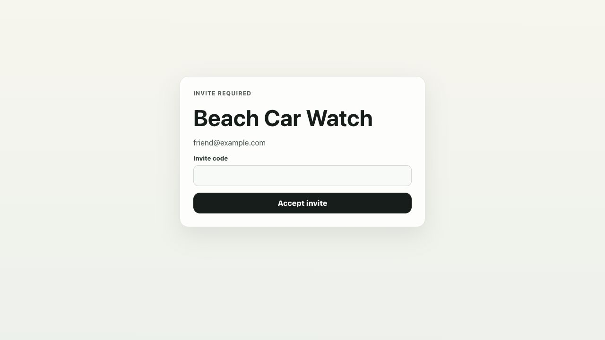

Onboarding, desktop:

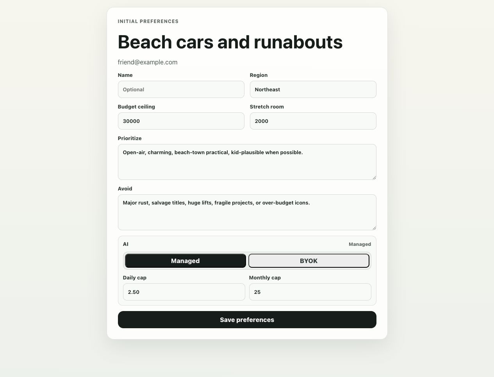

Onboarding, mobile:

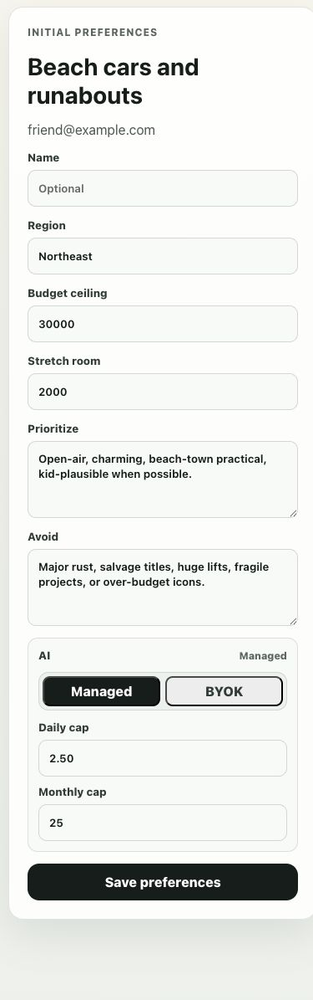

Admin console, desktop:

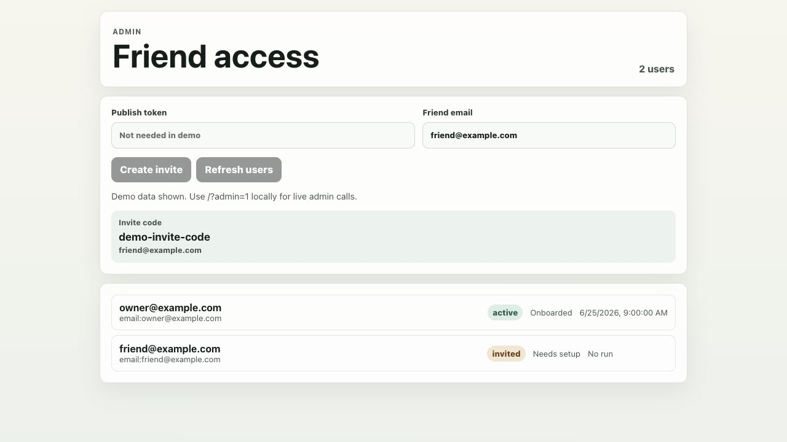

Admin console, mobile:

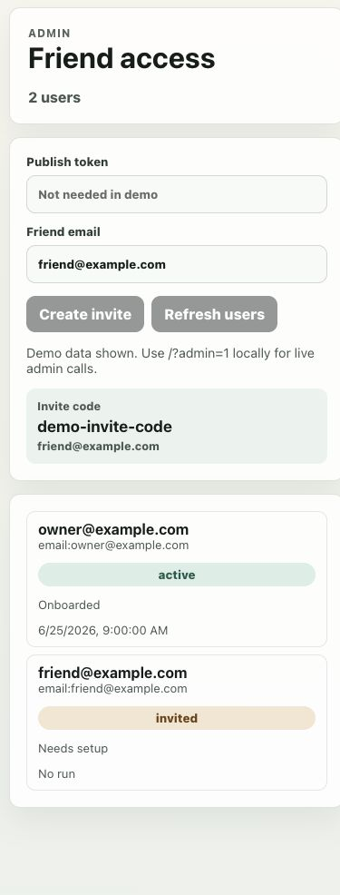

Preferences, desktop:

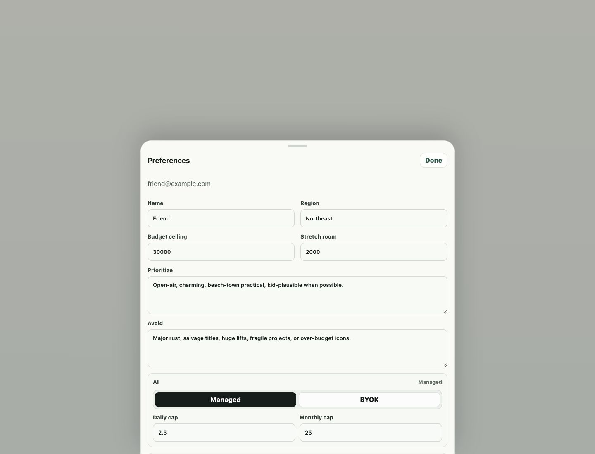

Preferences, mobile:

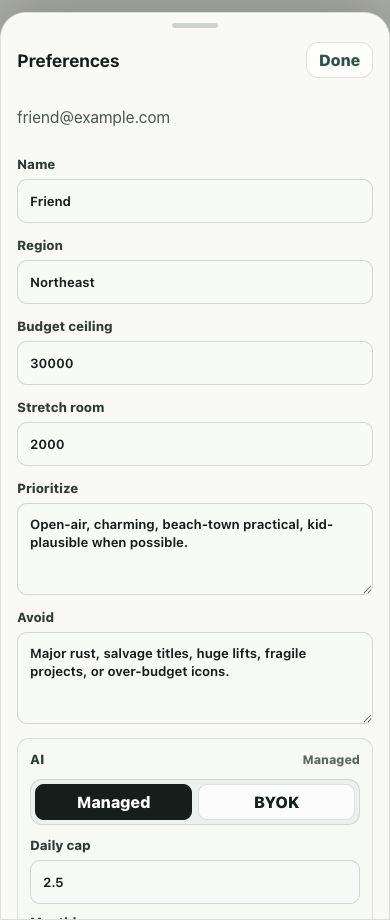

Preferences account controls, desktop:

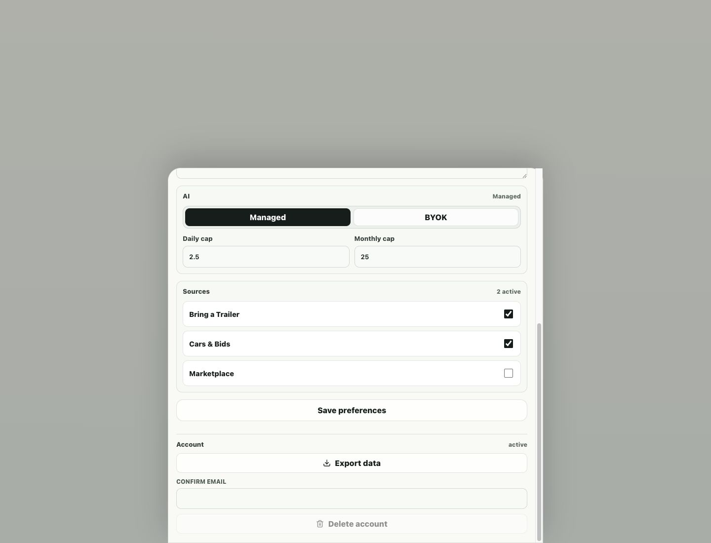

Preferences account controls, mobile:

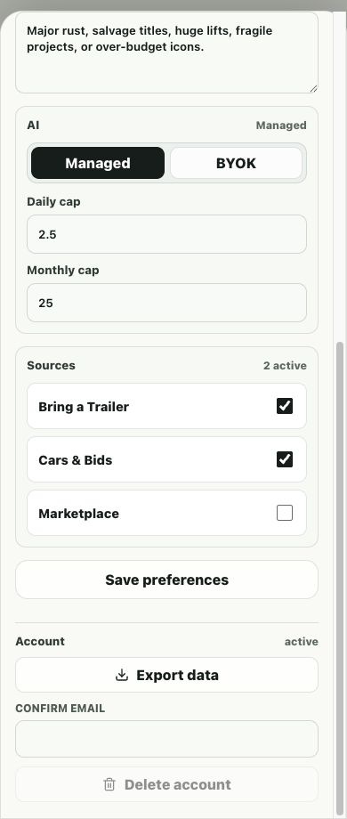

Run Detail, desktop:

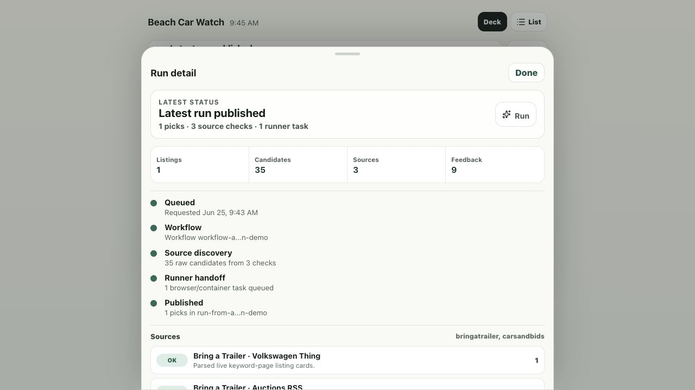

Run Detail, mobile:

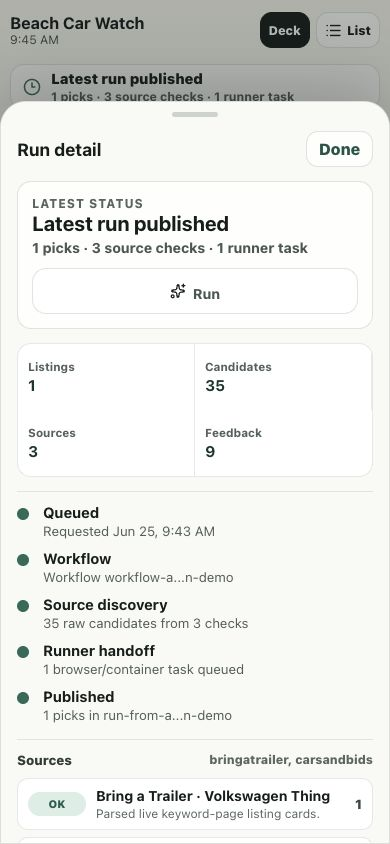

## Remaining Work

- Enable `bun run preflight:local` in CI once the CI environment can run local Wrangler/D1 state reliably; the quick `bun run preflight` CI workflow is now present.
- Deploy and exercise the Cloudflare Container runner for browser/session-heavy sources, and continue adding source-specific live connectors beyond the BaT keyword/RSS path.
- Exercise image variant creation against remote Worker bindings before production use; local source-image warmup is now covered by smoke.
- Re-run `bun run ios:test-ui` once CoreSimulator boots normally; the invite/onboarding/deck UI tests are now present but were not executed because the simulator timed out before launch.
- Exercise the AI Gateway scoring adapter against a real remote Gateway once credentials and budgets are ready; local wiring and usage recording are in place.
- Turn on credentialed Codex mode in the deployed Container runner and provision BYOK references through Cloudflare instead of saving references manually.
