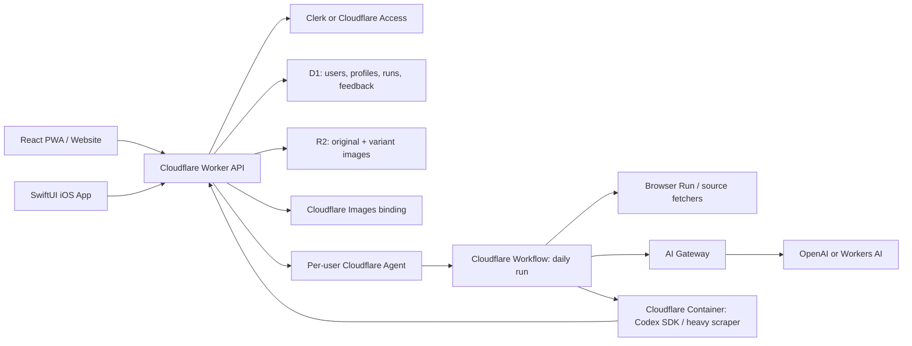

# Beachcar Friends Platform Plan

Date: 2026-06-25

## Clarifying Questions

1. Should friends all use the beach-car/runabout niche, or should each user be able to define a different collector niche?
2. Do you want this to stay invite-only, or should the website eventually support open signup?
3. Should friends bring their own OpenAI key, or would you rather front the model spend and cap each user through Cloudflare AI Gateway?
4. Should the first friend release support authenticated sources like Cars & Bids, or start with public sources only?
5. Should each user get an independent daily run on their own schedule/timezone, or should users share a common daily discovery pool with personalized ranking?
6. Do you want web onboarding first and iOS as a read/review client, or should iOS also support full account setup in the first release?
7. Which notifications matter first: email, web push, iOS push, SMS, or none?

Assumptions below: invite-only beta, each friend has their own profile and runs, use the existing beach-car profile as the default template, start with web onboarding plus iOS review, and support both managed model spend and BYO OpenAI key.

## First End-to-End Beta Slice

The first build should prove one complete loop for multiple users without trying to solve every source and credential problem at once:

1. Admin invites a friend by email.
2. Friend signs in with Clerk and accepts the invite.
3. Friend completes a beach-car profile: budget, location, schedule, source toggles, and taste notes.
4. The app creates a user-scoped daily run record and imports/publishes a run for that user.
5. The friend reviews listings in the PWA and iOS app.
6. Like/star/hide/avoid and preference notes are saved per user.
7. The next run export includes only that user's profile and feedback memory.
8. Listing images are served through cached variants instead of full originals.
9. Admin can see invite status, onboarding status, last run status, and basic model/image usage.

Acceptance criteria for the first slice:

- Two signed-in users can see different `/api/me` payloads, profile state, feedback, and latest runs.
- Existing single-user data is migrated to the owner's user row.
- Feedback export for user A never includes user B's feedback or preference notes.
- The web app works for onboarding and review.
- The iOS app can sign in and review an already-onboarded user's latest run.
- Images use stable variant URLs with long-lived cache headers.
- No raw OpenAI key is stored in D1.
- `bun run test` and `bun run typecheck` pass.

## Current State

The repo now has the first local friend-beta slice implemented:

- Cloudflare Worker serving a React PWA and JSON API.
- D1 for invited users, profiles, source settings, AI settings, usage events, Agent runs, runner tasks, user-scoped runs, listings, feedback, preference events, and image metadata.
- R2 image cache with `/api/images/:imageKey?variant=thumb|deck|full` delivery and generated image variants.
- Clerk auth with `ALLOWED_EMAIL` as the bootstrap owner, plus invite-only friend access.
- SwiftUI iOS app using ClerkKit and the same Worker API, with invite/onboarding gates, per-user latest-run cache, image prefetching, and run-status UI.
- Cloudflare Agents SDK Durable Object plus Workflow binding for per-user run requests and schedule state.
- Cloudflare Container runner scaffold and runner-task queue for Codex SDK/browser-heavy follow-up work.
- Hosted remote MCP preview at `/mcp`, with revocable scoped automation tokens, user-visible automation events, and a downloadable friend skill for cloud agents.
- Daily AI/publisher compatibility flow that imports normalized JSON and mirrors listing images.
- PWA onboarding and Preferences include structured taste calibration plus freeform notes, with selected archetypes composed into the existing automation preference context.

The remaining gaps before real friend use are deployment and remote-account validation: deployed D1 migrations, deployed Container runner, real AI Gateway budget/BYOK policy, remote image transform behavior, and live screenshots/UI tests in an environment where browser and CoreSimulator automation are available.

## Recent Cloudflare/OpenAI Releases To Use

- Cloudflare Agents is now positioned as a durable agent runtime: each agent session has identity, local SQL storage, real-time connections, scheduled work, and recoverable execution. Use it as the per-user orchestration/control plane. Source: [Cloudflare Agents docs](https://developers.cloudflare.com/agents/).
- Agents SDK primitives now emphasize durable execution, Code Mode, durable filesystem, dynamic workflows, and platform bindings. Useful for long-running daily research jobs and status streaming. Source: [Cloudflare Agents SDK / Flue announcement](https://blog.cloudflare.com/agents-platform-flue-sdk/).
- Agents can schedule delayed, date-based, and cron work directly, which maps cleanly to per-user daily runs. Source: [Agents schedule tasks](https://developers.cloudflare.com/agents/runtime/execution/schedule-tasks/).
- Workflows integrate with Agents for durable multi-step background processing with retries and external waits; use this for discovery, scoring, image processing, and publishing. Source: [Agents + Workflows](https://developers.cloudflare.com/agents/runtime/execution/run-workflows/).
- AI Gateway spend limits now support budgets scoped by model/provider/custom attributes, with identity-driven budgets in beta. This is the right cost-control layer for friends. Source: [AI Gateway spend limits](https://blog.cloudflare.com/ai-gateway-spend-limits/).
- AI Gateway BYOK stores provider keys once and references them through gateway configuration, backed by Secrets Store. This is preferable to storing raw OpenAI keys in D1. Source: [AI Gateway BYOK](https://developers.cloudflare.com/ai-gateway/configuration/bring-your-own-keys/).
- Secrets Store is account-level, encrypted, and integrates with Workers and AI Gateway. Use it for account/app secrets; use AI Gateway BYOK for model-provider keys. Source: [Secrets Store](https://developers.cloudflare.com/secrets-store/).
- Cloudflare Images binding can resize/transcode/manipulate images from R2, fetch responses, or raw bytes, but transformations are not automatically cached, so the Worker must add cache behavior. Source: [Optimize with Workers](https://developers.cloudflare.com/images/optimization/binding/).
- Cloudflare's June 22 Images-binding post says the binding was rearchitected for a more direct local connection between Workers and Images, and the post specifically calls out larger-image truncation failure modes that were fixed. That makes remote validation of our listing-image variants worth keeping on the pre-friend checklist. Source: [How we found a bug in the hyper HTTP library](https://blog.cloudflare.com/hyper-bug/).
- Cloudflare Containers can run a full Linux-like runtime and are controlled by Workers. This is the likely home for Codex SDK/CLI or heavier browser/scraper jobs that do not fit pure Workers. Source: [Cloudflare Containers](https://developers.cloudflare.com/containers/).
- Cloudflare Temporary Accounts let agents run temporary deploys for live previews, but this project should not use that path until you explicitly want remote previews. For this build, use local Wrangler/Vite only. Source: [Temporary Cloudflare Accounts for AI agents](https://blog.cloudflare.com/temporary-accounts/).
- OpenAI documents the Codex SDK as a server-side Node/Python interface for controlling Codex programmatically; the TypeScript library requires Node.js 18+. Source: [OpenAI Codex SDK](https://developers.openai.com/codex/sdk).
- Cloudflare documents routing OpenAI Codex through AI Gateway via custom provider config, useful for spend tracking when Codex itself is used. Source: [AI Gateway OpenAI Codex integration](https://developers.cloudflare.com/ai-gateway/integrations/coding-agents/openai-codex/).

## Product Shape

### Web Screens

1. **Invite / Sign In**
   - Magic-link or Google auth.
   - Invite code acceptance.
   - Explains that the app creates a private daily shortlist and stores taste feedback.

2. **Onboarding: Profile**
   - Niche template: Beach cars/runabouts, custom collector niche later.
   - Budget and stretch budget.
   - Location radius, shipping tolerance, excluded regions.
   - Primary lanes: family, solo, curiosity.

3. **Onboarding: Taste Calibration**
   - Swipe/rate 12-20 seed listings or archetypes.
   - Capture "show me more", "avoid", and freeform notes.
   - Writes initial `preference_events` and structured profile fields.

4. **Onboarding: Sources**
   - Select BaT, Cars & Bids, Marketplace/dealer sites later.
   - Start with public-source toggles.
   - Add authenticated-source connection later only if we have a clean credential/session model.

5. **Onboarding: AI & Budget**
   - Managed mode: app uses your Cloudflare AI Gateway with per-user budget.
   - BYO mode: user provides OpenAI key, key is stored through AI Gateway BYOK/Secrets Store, D1 stores only a reference.
   - Test key, set daily run budget, set fallback behavior.

6. **Today**
   - Existing deck/list experience.
   - Run status banner: pending, running, published, failed.
   - Feedback actions remain like/star/hide/avoid plus notes.

7. **Agent Run Detail**
   - Timeline of discovery, scoring, image processing, publish.
   - Errors visible in normal language.
   - "Run now" and "pause schedule" controls.

8. **Preferences**
   - Editable profile.
   - Feedback memory: liked/starred/avoided listings.
   - Source toggles and schedule.
   - Data export/delete.

9. **Admin**
   - Invite users.
   - See active users, last run status, image/storage usage, model spend.
   - Feature flags for experimental sources/agents.

### iOS Screens/Changes

- Keep the deck/list/detail review as the core mobile experience.
- Add onboarding-required state when `/api/me` reports no completed profile.
- Add profile/settings view for budget, location, schedule, source toggles, and AI mode summary.
- Remove hardcoded `allowedEmail`; the server decides authorization and onboarding state.
- Add account switch/sign-out handling suitable for multiple Clerk users.
- Add run-status UI so users know whether today's run is still processing.
- Add offline image/listing cache and preload the next listings.

## Architecture

Recommended first production architecture:

- **Worker API** remains the primary product API and static asset host.
- **D1** becomes multi-tenant relational state.
- **R2 + Images binding** becomes a derivative image pipeline instead of only original mirroring.
- **Per-user Agent Durable Object** owns user-specific state, schedule, current run status, and WebSocket/SSE progress.
- **Workflow** owns durable daily run execution, retries, and partial progress.
- **AI Gateway** centralizes all model calls, spend attribution, caching/rate limits, and optional BYOK.
- **Container runner** is used only where needed: Codex SDK, Playwright-heavy browsing, shell tooling, or anything requiring a full Node/Linux environment.

### Why not run everything in one Worker?

Workers are excellent for API, auth, lightweight fetches, D1/R2 operations, and image transforms. Codex SDK is documented as a server-side Node/Python SDK, and the current auction automation has browser/session/scraping needs. Those parts should be isolated in a Container or external runner. The Worker/Agent should orchestrate and own state, not pretend to be a full Linux job runner.

## Data Model Changes

Add user scope instead of duplicating the whole database per friend.

Core tables:

- `users(id, auth_provider, auth_subject, email, display_name, status, invited_by_user_id, created_at, last_seen_at)`
- `invites(id, email, code_hash, invited_by_user_id, accepted_by_user_id, expires_at, created_at, accepted_at)`
- `profiles(user_id, name, niche, budget_min, budget_max, stretch_budget, home_region, timezone, schedule_cron, profile_json, onboarding_completed_at, updated_at)`
- `source_settings(user_id, source, enabled, settings_json, created_at, updated_at)`
- `user_ai_settings(user_id, mode, gateway_key_ref, monthly_budget_cents, daily_budget_cents, status, updated_at)`
- `runs(id, user_id, generated_at, status, report_markdown, source_summary_json, created_at, completed_at, error)`
- `listings(listing_key, site, title, url, lane, first_seen_at, last_seen_at, last_payload_json)`
- `run_listings(run_id, listing_key, sort_order, payload_json)`
- `feedback(user_id, listing_key, action, tags_json, note, updated_at)` with primary key `(user_id, listing_key)`
- `preference_events(id, user_id, listing_key, event_type, note, transcript, tags_json, created_at)`
- `images(image_key, listing_key, source_url, r2_original_key, content_type, byte_length, status, error, copied_at, created_at, updated_at)`
- `image_variants(image_key, variant, r2_key, width, height, content_type, byte_length, status, created_at)`
- `agent_runs(id, user_id, workflow_instance_id, status, started_at, finished_at, progress_json, error)`

Keep `listings` and source image records global by URL/listing key to dedupe across friends, but make runs, feedback, preferences, AI settings, and profile data user-owned.

## Key Handling

Preferred order:

1. **Managed spend beta**: do not ask friends for OpenAI keys. Use your Cloudflare AI Gateway, tag requests with `user_id`, enforce per-user budgets, and show spend in admin.
2. **BYO key beta**: accept key once, test it, store through AI Gateway BYOK/Secrets Store, store only `gateway_key_ref` in D1, support rotate/delete, never expose the value back to clients.
3. **Avoid**: encrypting raw user OpenAI keys into D1 unless there is no viable Gateway/BYOK route. It increases breach blast radius and operational burden.

For Codex specifically, use a Container runner with either:

- an AI Gateway-backed Codex provider profile, so Codex calls route through Cloudflare; or
- a short-lived job environment with the user's provider key injected for that run only.

Do not run Codex SDK directly in the browser or expose model keys to clients.

## Security And Privacy Requirements

- Treat every authenticated request as user-scoped. Server handlers should derive `user_id` from the verified auth subject, not from client-provided ids.
- Keep admin APIs separate from user APIs. Admin routes require publisher/admin authorization and should never infer admin rights from normal sign-in alone.
- Store OpenAI/provider credentials only as external secret references. D1 may store mode, status, redacted display labels, and secret/gateway references.
- Add audit events for invite creation, invite acceptance, profile updates, AI key changes, run starts, run failures, and data deletion.
- Support account export and deletion before inviting non-technical friends. Deletion should remove profile, feedback, preference events, source settings, AI references, and user-scoped runs while preserving globally shared listing/image cache rows only when still referenced by other users.
- Keep source credentials out of the first release unless there is an explicit per-source security design.
- Log model usage with `user_id`, run id, provider, model, estimated tokens/cost, and gateway status, but never prompts that contain private keys or source credentials.
- Keep the app private by default: invite-required signup, rate limits on auth-sensitive endpoints, and no indexable public listing pages.

## Daily Agent Flow

1. User completes onboarding.
2. Worker creates/updates the user's Agent instance.
3. Agent schedules the next daily run based on profile timezone and schedule.
4. Schedule fires and starts a Workflow.
5. Workflow loads profile, source settings, feedback export, and prior preference events.
6. Workflow discovers candidates:
   - public fetch/scrape in Worker where possible,
   - Browser Run or Container for rendered/authenticated sources,
   - source-specific throttling and compliance rules.
7. Workflow scores candidates with AI Gateway/OpenAI/Workers AI.
8. Workflow normalizes output to the existing `AuctionListing` shape plus discovery metadata.
9. Workflow imports run rows, starts image mirroring/variant generation, and marks run as published.
10. Agent broadcasts progress to web/mobile and optionally sends notifications.

## API Contract For The Beta Slice

User routes:

- `GET /api/me` -> `{ user, profile, onboarding, capabilities }`
- `PUT /api/profile` -> create/update the signed-in user's profile.
- `GET /api/runs/latest` -> latest run for the signed-in user only.
- `GET /api/runs/:runId` -> user-owned run detail.
- `POST /api/runs/:runId/retry` -> enqueue/retry a user-owned run when allowed.
- `GET /api/feedback/export` -> signed-in user's feedback export.
- `PUT /api/feedback/:listingKey` -> signed-in user's listing feedback.
- `DELETE /api/feedback/:listingKey` -> clear signed-in user's listing feedback.
- `POST /api/preference-events` -> signed-in user's note/view event.
- `GET /api/automation/status` -> signed-in user's MCP endpoint, token status, OAuth preview status, and recent automation events.
- `POST /api/automation/tokens` -> create a revocable scoped automation token and return the secret once.
- `DELETE /api/automation/tokens/:id` -> revoke one signed-in user's automation token.
- `GET /api/automation/bundle` -> generate the friend cloud-agent skill with the current `/mcp` endpoint.
- `GET /api/images/:imageKey/:variant?` -> cached image variant; auth can be required for beta.

Admin routes:

- `POST /api/admin/invites` -> create invite.
- `GET /api/admin/users` -> user/invite/run summary.
- `POST /api/admin/import` -> temporary compatibility route; accepts owner user id until the agent pipeline replaces it.
- `POST /api/admin/users/:userId/runs/import` -> import one user's run.
- `GET /api/admin/users/:userId/feedback/export` -> export one user's steering memory for the runner.
- `PUT /api/admin/images/:listingKey/:imageKey` -> compatibility image upload route.

Remote MCP tools:

- `get_setup_context` -> user profile/source/feedback/latest-run/AI-budget context.
- `plan_daily_research` -> source checklist and publish contract for a cloud agent.
- `search_bat_cache` -> searches D1-cached Bring a Trailer public RSS candidates and refreshes the cache when empty or stale.
- `submit_candidates` -> validate/normalize listings before publishing.
- `publish_run` -> user-scoped run import plus image warmup.
- `record_usage` -> AI/token/cost usage events for the external agent.
- `verify_latest_run` -> read back the published user-scoped run.
- `list_automation_events` -> user-visible automation activity log.

Migration sequence:

1. Create `users`, `invites`, `profiles`, `source_settings`, `user_ai_settings`, `agent_runs`, `audit_events`, `image_variants`, source-cache tables, and automation-token tables.
2. Add nullable `user_id` and `status` columns to `runs`.
3. Backfill one owner user and set all existing runs to that user.
4. Replace `feedback` with a `(user_id, listing_key)` primary key table.
5. Add `user_id` to `preference_events` and backfill owner user.
6. Update queries and tests to prove per-user isolation.
7. Once deployed and verified, make required `user_id` assumptions in code even if D1 cannot enforce every existing column as `NOT NULL`.

Verification gates:

- Unit tests for invite acceptance, profile upsert, feedback isolation, preference event isolation, latest-run isolation, and feedback export isolation.
- Typecheck for client, worker, and tests.
- Local D1 migration apply against an empty database and a copy with pre-migration sample data.
- PWA smoke test: sign in as two test users, complete onboarding for one, verify user-specific latest run/feedback.
- iOS build after API shape changes.

## Image Pipeline

Current behavior mirrors source images to R2, returns variant image URLs in latest-run payloads, generates variants on warmup/first request, stores variants in R2, and serves immutable cached responses from `/api/images/:imageKey?variant=thumb|deck|full`.

- Image variants:
  - `thumb`: 320px wide, WebP/AVIF, list thumbnails and preloads.
  - `deck`: 960px wide, WebP/AVIF, deck primary image.
  - `full`: 1600px wide, WebP/JPEG fallback, zoom/detail.
  - Optional `blur`: tiny placeholder or blurhash-like metadata.
- Use content-addressed keys: `images/{imageKey}/{variant}.{format}`.
- Done locally: add `image_variants` table and return variant URLs instead of full original URLs for deck/list contexts.
- Done locally: cache transformed responses explicitly because transformed image responses are not automatically durable storage.
- Done locally: send long-lived immutable cache headers for variant URLs.
- Done locally: dedupe source images globally across users by `source_url`/`imageKey`.
- Remote validation: exercise variant generation against deployed Worker bindings and decide whether to keep the current `fetch(..., { cf: { image } })` transform path or move transforms to the Cloudflare Images binding from R2 bytes.
- Add R2 lifecycle policy:
  - keep current-run variants hot,
  - expire failed/pending originals after a short window,
  - optionally expire old originals after 30-90 days if variants are enough.

Client behavior:

- PWA service worker:
  - done locally: do not cache authenticated JSON API responses,
  - done locally: cache-first immutable image variants,
  - done locally: prefetch nearby deck/thumb images in the review flow.
- iOS:
  - done locally: configure `URLCache` with a larger disk budget,
  - done locally: prefetch nearby deck/thumb images,
  - done locally: keep decoded images in `NSCache`,
  - done locally: persist latest run JSON per user for offline review.

## Implementation Phases

### Phase 1: Multi-user Core

- Done locally: add users, invites, profiles, user-scoped feedback/events/runs.
- Done locally: change auth from single `ALLOWED_EMAIL` allowlist to bootstrap owner plus invite/user lookup.
- Done locally: update `/api/me` to return user, profile, onboarding status, capabilities, source settings, AI settings, and usage summary.
- Done locally: migrate existing single-user data to the owner user row.
- Done locally: keep daily publishing admin token working for the owner account.

### Phase 2: Web Onboarding

- Done locally: build invite acceptance and onboarding screens.
- Done locally: add structured taste calibration with editable "show more" archetypes, "avoid" deal-breakers, and freeform notes.
- Done locally: add profile editor and source settings.
- Done locally: add AI mode selection, managed/BYOK references, and daily/monthly caps.
- Done locally: add admin invite dashboard.

### Phase 3: Agent MVP

- Done locally: add `agents` package and per-user `BeachcarAgent` class.
- Done locally: Agent stores run state, accepts manual run requests, and syncs completed users' cron schedules.
- Done locally: Workflow performs public-source discovery, optional AI Gateway scoring, user-scoped import, image warmup, and blocked-source runner-task creation.
- Done locally: show run progress/status and source-summary detail in the PWA.

### Phase 4: BYOK / Spend Controls

- Done locally: integrate AI Gateway request metadata with `user_id`, Agent run id, operation, and mode.
- Done locally: add BYOK flow using AI Gateway/Secrets Store references and reject raw provider keys.
- Partial: add save/delete of references and account deletion cleanup; production rotate/test-key controls still need the real Gateway integration.
- Done locally: add admin/user spend views and usage ledger.

### Phase 5: Image Performance

- Done locally: add image variants and endpoint/API shape.
- Done locally: generate variants on import warmup or first request.
- Done locally: update PWA and iOS to use `thumb`, `deck`, and `full` URLs.
- Done locally: add preload/cache behavior and storage audits.

### Phase 6: iOS Multi-user

- Done locally: remove local single-user assumptions.
- Done locally: add invite/onboarding-required state and profile/settings save.
- Done locally: add run status.
- Done locally: add image prefetch/cache.
- Ship via TestFlight.

### Phase 7: Heavier Automation

- Done locally: add a user-owned `runner_tasks` queue and admin claim/complete/fail contract for Container/Codex/browser work.
- Done locally: add a Cloudflare Container runner scaffold and local HTTP contract for Codex SDK/browser work, with deterministic default mode and an explicit `BEACHCAR_RUNNER_MODE=codex` deployment toggle.
- Partial: add BaT keyword/RSS source connectors and blocked Cars & Bids runner-task handoff.
- Add Browser Run for rendered pages where it is enough.
- Add compliance/rate-limit controls per source.

## Main Risks

- **BYO keys**: storing friends' keys is sensitive. Prefer AI Gateway BYOK references and budgets; avoid raw D1 secrets.
- **Authenticated auction sources**: browser sessions and terms vary. Start public-only unless friends explicitly need C&B/private sessions.
- **Codex in Workers**: Codex SDK should not be assumed to run inside a Worker. Treat Container runner as the boundary.
- **Cost blowups**: every user creates recurring model and browser work. AI Gateway budgets and per-user run caps should be in the first beta, not later.
- **Storage growth**: variants help bandwidth, but per-user runs multiply images. Global dedupe and lifecycle policy matter.
- **App Store review/privacy**: if friends bring API keys or source credentials, the privacy posture and account deletion/export flows need to be crisp.

## Recommendation

Build this as an invite-only, multi-tenant Cloudflare app with Clerk left in place for the first beta because iOS already depends on ClerkKit. Add Cloudflare Agents/Workflows for per-user scheduling and run orchestration, AI Gateway for all model calls and cost controls, R2 plus Images binding for variants, and Containers only for Codex SDK or browser-heavy jobs.

For the first friend release, do not require OpenAI keys. Use managed AI Gateway with low per-user daily/monthly limits, prove the onboarding and per-user run loop, then add BYOK once the product shape is stable.
