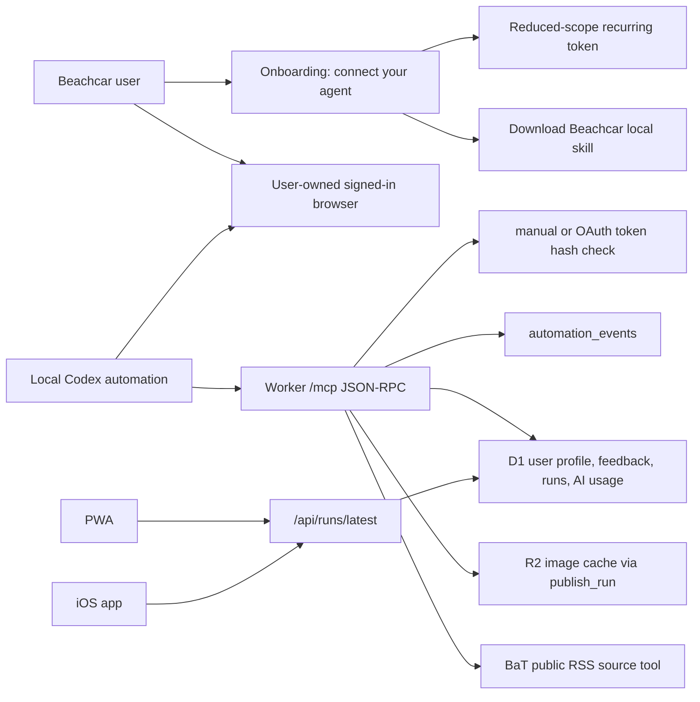

# Beachcar Agent-Connected MCP Curation

Date: 2026-06-25

## Goal

Make a user's own local Codex the default curation engine: it gathers listings in the user's browser, publishes a user-scoped run, and verifies the result through the hosted MCP. Beachcar does not run or pay for inference in this path.

This is the **default workflow**. Beachcar owns durable taste memory, feedback, evidence, publishing, and the review experience; Codex, Claude, or another MCP client owns research tools and inference. Beachcar stores no provider key and charges nothing for this path.

The recurring path uses a revocable, reduced-scope `bcauto_...` bearer token. OAuth authorization-code + PKCE remains available for supervised interactive previews, but its one-hour access token has no refresh-token path and must not be presented as recurring-ready. The hosted metadata surface is deployed, while a real remote Clerk session plus external MCP client still needs end-to-end validation.

## Architecture

## Implemented Surface

Website routes:

- `GET /api/automation/status`: returns MCP endpoint, OAuth status, default scopes, redacted manual/OAuth tokens, and recent automation events.
- `POST /api/automation/tokens`: creates a token, returns the secret once, stores only a hash.
- `DELETE /api/automation/tokens/:id`: revokes one token for the signed-in user.
- `DELETE /api/automation/oauth-tokens/:id`: revokes one OAuth connection for the signed-in user without requiring the raw bearer token.
- `GET /api/automation/events`: returns recent user-scoped automation events.
- `GET /api/automation/bundle`: returns a generated `SKILL.md` with the current MCP endpoint filled in.

Remote MCP route:

- `GET /mcp`: returns server/tool metadata for setup.
- `POST /mcp`: accepts JSON-RPC requests with `Authorization: Bearer <automation-token>`.

OAuth discovery routes:

- `GET /.well-known/oauth-protected-resource/mcp`: returns OAuth protected-resource metadata for the hosted `/mcp` endpoint.
- `GET /.well-known/oauth-protected-resource`: returns the same metadata as a host-level compatibility fallback.
- Unauthorized `/mcp` JSON-RPC requests return `WWW-Authenticate: Bearer resource_metadata="..."` so MCP clients can discover the protected-resource metadata URL.

OAuth authorization-server routes:

- `GET /.well-known/oauth-authorization-server`: returns authorization server metadata, including authorization, token, registration, and revocation endpoints.
- `POST /oauth/register`: dynamically registers a public OAuth client with HTTPS or localhost redirect URIs.
- `GET /oauth/authorize`: issues authorization codes for signed-in active Beachcar users. The local verifier uses `X-Beachcar-Test-Email`; remote deploys should use a real Clerk bearer session.
- `POST /oauth/token`: exchanges an authorization code plus S256 PKCE verifier for a short-lived `bcoauth_...` access token audience-bound to `/mcp`.
- `POST /oauth/revoke`: revokes an OAuth access token.

MCP methods:

- `initialize`
- `tools/list`
- `tools/call`

MCP tools:

- `get_setup_context`
- `plan_daily_research`
- `save_taste_calibration`: persists a confirmed, bounded local-Codex taste interview without enabling managed research or a cloud schedule.
- `search_bat_cache`: searches D1-cached Bring a Trailer public RSS candidates and refreshes the cache when empty or stale.
- `submit_candidates`
- `publish_run`
- `record_usage`
- `verify_latest_run`
- `list_automation_events`

`submit_candidates` and `publish_run` accept the full listing shape from `docs/publishing.md`, including the optional nested `dossier` object (rich per-car detail: specs, full writeup, equipment, service, bid log, comments, beach-use fit, and a 0..1 `valueScore`). All dossier fields are optional and are coerced/validated on import.

## Token Model

Manual automation tokens are user-owned and revocable:

- Secret format: `bcauto_<token-id>.<random-secret>`
- Stored value: SHA-256 hash of the whole token.
- Token metadata: label, scopes, created time, last used time, revoked time.
- Canonical recurring scopes: `setup:read`, `setup:write`, `sources:read`, `runs:publish`, `events:read`.
- `usage:write` is intentionally omitted because the user's local Codex subscription and browser activity are not Beachcar-managed AI usage.
- Every MCP call touches `last_used_at`; tools also write `automation_events`.

OAuth access tokens are also user-owned:

- Secret format: `bcoauth_<token-id>.<random-secret>`
- Stored value: SHA-256 hash of the whole token.
- Token metadata: client id, scopes, `/mcp` resource audience, created time, last used time, expiry, and revoked time.
- Authorization codes expire after 10 minutes and are single-use.
- Access tokens expire after 1 hour and are rejected unless their resource audience exactly matches the hosted `/mcp` endpoint.
- Beachcar does not issue OAuth refresh tokens yet. OAuth is an interactive-preview path, not the credential for a recurring automation.
- The Preferences panel lists active/revoked OAuth connections by registered client name and can revoke them by id.
- OAuth-authenticated MCP tool events set `token_id` to `null` and include `authKind`, `oauthAccessTokenId`, and `oauthClientId` in event metadata.

No raw provider/model key is accepted by this system. The canonical local path does not call `record_usage`; the user already owns their Codex subscription.

## App screen

Onboarding selects **Connect your own agent** by default and places the connection controls directly in the setup flow. Preferences keeps the same controls visible whenever agent-connected mode is selected. The panel:

- Shows the absolute `/mcp` endpoint.
- Creates a reduced-scope token for the user's local Codex.
- Displays the token once with copy affordance.
- Downloads the Beachcar daily-run skill.
- Lists recent active/revoked manual tokens and OAuth connections.
- Revokes OAuth connections by id without showing or storing raw access tokens.
- Shows recent automation events.
- Shows OAuth discovery and authorization-server endpoints while retaining scoped tokens for fallback clients.

## Skill

The canonical skill for this path lives at:

- `.agents/skills/beachcar-daily-run/SKILL.md`

The website bundle route emits the same workflow with the current deployment's MCP endpoint inserted. The skill tells a local Codex automation to use the reduced-scope recurring token, run a confirmed taste interview through `save_taste_calibration`, use the user's already-signed-in browser where needed, publish through `publish_run`, and verify with `verify_latest_run`.

The deadline-safe installer lives at `scripts/install-beachcar-codex.sh`. It:

- reads the one-time `bcauto_...` secret without echo from `/dev/tty`,
- preserves unrelated variables while storing `BEACHCAR_MCP_TOKEN` in `~/.codex/.env` with mode `0600`,
- copies the skill into `~/.codex/skills/beachcar-daily-run`,
- runs `codex mcp add` with `--bearer-token-env-var BEACHCAR_MCP_TOKEN`, never the token value,
- allows only the eight setup/research/publish/verify/event tools, sets approval to `approve` for that one MCP server, and keeps `save_taste_calibration` on `prompt`, and
- leaves all unrelated Codex configuration and MCP servers intact.

This secret-loading path was checked against the current Codex desktop bundle on 2026-07-20 (`codex-cli 0.145.0-alpha.18`). Codex's startup entrypoint loads `$CODEX_HOME/.env`—`~/.codex/.env` by default—before it initializes MCP servers and rejects `CODEX_*` keys from that file. See the [OpenAI Codex `arg0` entrypoint](https://github.com/openai/codex/blob/main/codex-rs/arg0/src/lib.rs). A full Codex restart is therefore required after installation.

The skill now includes explicit setup guidance for hosted MCP clients:

- add the hosted `/mcp` endpoint with `bearer_token_env_var`, the Beachcar tool allowlist, `default_tools_approval_mode = "approve"`, and a per-tool prompt for taste writes,
- conduct a short confirmed taste interview before saving calibration through MCP,
- reserve OAuth protected-resource discovery and authorization-code + PKCE for a supervised interactive preview,
- stop rather than inventing an API fallback if hosted MCP tools are unavailable,
- use `search_bat_cache` before direct BaT browsing,
- keep local Codex/browser work out of Beachcar's managed AI accounting,
- let the user perform sign-in, MFA, CAPTCHA, and permission prompts in the browser,
- require the Mac to be awake and Codex to be running at the scheduled time,
- keep `save_taste_calibration` out of scheduled runs; incomplete setup returns to a supervised session,
- write blocked sources or manual-check caveats into `sourceSummary`,
- finish only after `publish_run` and `verify_latest_run` agree on the run id and listing count.

## Image Handling

`publish_run` reuses the existing import path. That path stores listing/image metadata in D1, queues image warmup through `ctx.waitUntil(prewarmImportedImages(...))`, mirrors source images into R2, and serves `thumb`, `deck`, and `full` variants through `/api/images/:imageKey?variant=...`.

That means runs published by a friend's cloud agent should behave the same as Workflow or admin-import runs in both the PWA and iOS app.

## Source Cache

Bring a Trailer RSS ingestion is persisted in D1:

- `source_items` stores deduped listing/feed candidates by URL.
- `source_ingestion_runs` records every scheduled/manual refresh.
- A 15-minute Worker cron refreshes the BaT public auctions RSS feed.
- Admins can inspect and refresh the cache through `/api/admin/source-cache/status` and `/api/admin/source-cache/ingest`.
- The admin console surfaces that same status with freshness, item counts, latest ingestion result, and a manual BaT RSS ingest control.

## Follow-up

Authorization-code + PKCE is implemented and locally verified through `bun run cloudflare:verify`; the deployed metadata and unauthenticated challenge are also verified. Remaining work before offering agent-connected curation more broadly:

1. Validate the OAuth flow on a deployed Worker with a real Clerk bearer session and at least one real MCP client.
2. Add and expiry-test refresh tokens before promoting OAuth from interactive preview to recurring use.
3. Preserve `automation_events` as the user-visible activity log.
4. Keep `publish_run` and source tools stable so the recurring local Codex task does not need a custom integration.
