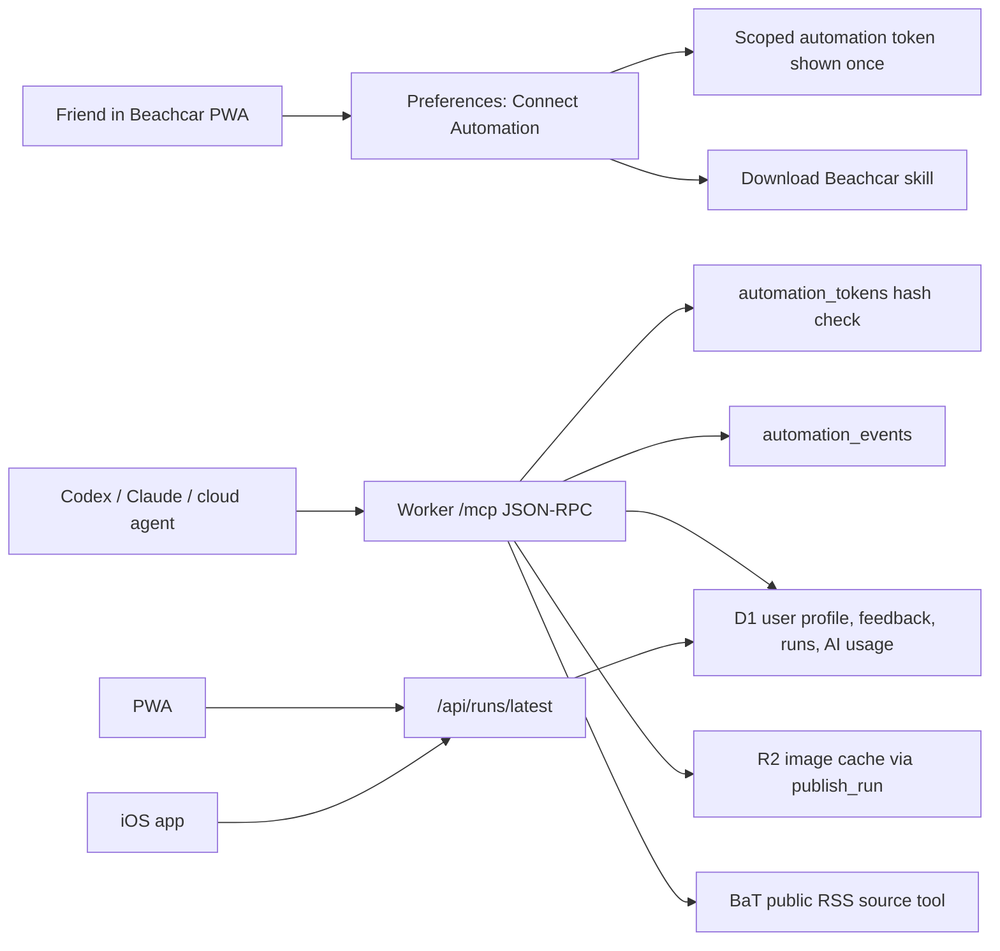

# Beachcar Remote MCP Friend Automation

Date: 2026-06-25

## Goal

Let a friend configure Beachcar in the website, create a scoped automation credential, give that credential plus a downloadable skill to a cloud agent of their choice, and have that agent gather listings, publish a user-scoped run, record AI usage, and verify the app without running any local MCP server.

This is a preview implementation. Production should replace the manually issued bearer token with a real remote MCP OAuth flow, but the tool contracts and event model are intentionally shaped so that OAuth can issue the same scopes later.

## Architecture

## Implemented Surface

Website routes:

- `GET /api/automation/status`: returns MCP endpoint, OAuth status, default scopes, redacted tokens, and recent automation events.
- `POST /api/automation/tokens`: creates a token, returns the secret once, stores only a hash.
- `DELETE /api/automation/tokens/:id`: revokes one token for the signed-in user.
- `GET /api/automation/events`: returns recent user-scoped automation events.
- `GET /api/automation/bundle`: returns a generated `SKILL.md` with the current MCP endpoint filled in.

Remote MCP route:

- `GET /mcp`: returns server/tool metadata for setup.
- `POST /mcp`: accepts JSON-RPC requests with `Authorization: Bearer <automation-token>`.

MCP methods:

- `initialize`
- `tools/list`
- `tools/call`

MCP tools:

- `get_setup_context`
- `plan_daily_research`
- `search_bat_cache`
- `submit_candidates`
- `publish_run`
- `record_usage`
- `verify_latest_run`
- `list_automation_events`

## Token Model

Tokens are user-owned and revocable:

- Secret format: `bcauto_<token-id>.<random-secret>`
- Stored value: SHA-256 hash of the whole token.
- Token metadata: label, scopes, created time, last used time, revoked time.
- Default scopes: `setup:read`, `sources:read`, `runs:publish`, `usage:write`, `events:read`.
- Every MCP call touches `last_used_at`; tools also write `automation_events`.

No raw provider/model key is accepted by this system. AI cost attribution is recorded through `record_usage`; actual model payment depends on the friend or owner automation setup.

## App Screen

Preferences now includes **Connect automation**:

- Shows the absolute `/mcp` endpoint.
- Creates a token for a friend cloud agent.
- Displays the token once with copy affordance.
- Downloads the Beachcar daily-run skill.
- Lists recent active/revoked tokens.
- Shows recent automation events.
- Explains that OAuth is planned and the current preview uses scoped tokens.

## Skill

The canonical repo skill lives at:

- `.agents/skills/beachcar-daily-run/SKILL.md`

The website bundle route emits the same workflow with the current deployment's MCP endpoint inserted. The skill tells a cloud agent to use the hosted MCP tools, gather candidates, publish through `publish_run`, call `record_usage`, and verify with `verify_latest_run`.

## Image Handling

`publish_run` reuses the existing import path. That path stores listing/image metadata in D1, queues image warmup through `ctx.waitUntil(prewarmImportedImages(...))`, mirrors source images into R2, and serves `thumb`, `deck`, and `full` variants through `/api/images/:imageKey?variant=...`.

That means runs published by a friend's cloud agent should behave the same as Workflow or admin-import runs in both the PWA and iOS app.

## OAuth Follow-Up

The preview bearer-token flow should become OAuth before broader use:

1. Add MCP OAuth metadata and authorization endpoints.
2. Issue short-lived access tokens with the same scope vocabulary.
3. Keep refresh/revoke flows in the user's Connect Automation screen.
4. Preserve `automation_events` as the user-visible activity log.
5. Keep `publish_run`, `record_usage`, and source tools unchanged so cloud agents do not need a new workflow.
